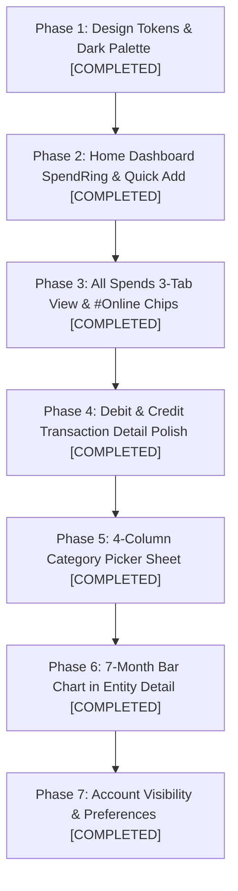
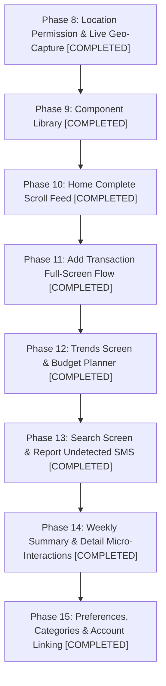

# Axio-Style Expense Tracker: UI Specification & Adaptation Plan

**Version:** 1.0  
**Date:** October 2026  
**Status:** Approved for Implementation  
**Companion Documents:** [SRS.md](file:///Users/krish/Developer/Kharcha/docs/SRS.md), [UI_SPEC.md](file:///Users/krish/Developer/Kharcha/docs/UI_SPEC.md), [TechDoc.md](file:///Users/krish/Developer/Kharcha/docs/TechDoc.md)

---

## 1. Executive Summary & Product Scope

This document specifies the redesign of **Kharcha** adopting the modern, dark-theme, card-based aesthetic of **Axio (formerly Walnut)**, while tailoring it strictly to Kharcha's core mission: **a 100% offline, privacy-first, automated SMS personal expense tracker**.

### Scope Adaptations: Kharcha vs. Axio

Axio includes auxiliary financial products such as personal loans, Buy-Now-Pay-Later (BNPL / "axio Pay Later"), credit lines, and social friend-splitting (Splitwise integration). Kharcha deliberately excludes these to remain a lightweight, secure utility.

| Feature Area | Axio Feature | Kharcha Adaptation (Pure Expense Tracker) |
| :--- | :--- | :--- |
| **Lending & BNPL** | "axio Pay Later", loan applications, credit line dues. | **Excluded completely**. No credit line/loan marketing. The 4th bottom navigation icon represents **Insights / Analytics** or **Settings / Accounts**, not BNPL dues. |
| **Bill Reminders** | Pay later bill payments via payment gateway. | **Local utility bill reminders** parsed from bank/utility SMS, tracked against accounts. |
| **Split with Friends** | Social friend network / Splitwise sync. | **Local share calculation only**: Allows marking an expense as split (e.g. 50% split with roommate) so that only the user's net spend is counted towards their monthly totals. |
| **Accounts** | Linked partner NBFC accounts & credit cards. | **Local Bank & Wallet Accounts**: Accounts detected from SMS sender handles and reference numbers. User can toggle visibility per account with an eye icon. |
| **Privacy & Storage** | Cloud sync and server backup. | **Zero Internet permission**. Everything stays on-device in Room database and encrypted SharedPreferences. |

---

## 2. Global Design System & Tokens

### 2.1 Theme & Color Palette
- **Mode:** Dark only. Soft, rounded, dark-elevation card architecture.
- **Backgrounds:**
  - Screen Background: `#121212` to `#161616`
  - Elevated Card / Surface: `#232323` to `#2A2A2A`
  - Raised Row inside Card: `#2E2E2E`
  - Hairline Dividers: `#333333`
- **Primary & Accent Colors:**
  - **Lime Green Accent (`#A8E04A`)**: Active tab indicator glow, "Set budget" actions, active bottom nav icon, toggles (ON), income icons/arrows.
  - **Pale Lime (`#C8F08F`)**: Fill for primary "+ Add" action pill button with dark text (`#121212`).
  - **Chart Blue (`#4B4FE6`)**: Monthly bar chart columns; selected/current month bar has a lighter highlight.
  - **Account Row Navy (`#1F2D3D`)**: Detail screen bank account pill container.
  - **Online Tag Blue (`#1E293B` container, `#38BDF8` text)**: `#Online` merchant tag badge.
- **Financial Status Colors:**
  - **Income / Credit:** `#4ADE80` (lime/green) with `↙` direction arrow.
  - **Expense / Debit:** `#FB923C` or `#FFFFFF` (depending on card context) with `↗` direction arrow.
  - **Transfer / Reconciled:** `#94A3B8` (blue-grey) with swap icon.
  - **Warning / Exceeded:** `#FBBF24` (warning) and `#F87171` (budget exceeded).
- **Typography:**
  - Rounded geometric sans (`Outfit` or `Google Sans` style) with tabular figures for numbers.
  - Hero Amounts: 40–48sp, medium / bold.
  - Screen Titles: 18sp, semi-bold.
  - List Item Titles: 16sp, medium.
  - Section Labels ("Recent transactions"): 18sp, bold.
  - Subtitles / Timestamps: 12sp, `#9E9E9E`.
- **Shapes & Elevation:**
  - Cards: 16–24dp rounded corners.
  - Buttons and Chips: Fully rounded pill shape (`CircleShape` / 100dp).
  - Tonal elevation without harsh drop shadows.

### 2.2 Micro-Interactions & Feedback
- **Pill Toast:** Bottom-anchored dark pill toast with a small lime green icon for immediate action feedback:
  - *"Will not be counted in total spends"*
  - *"Will be counted in income"*
  - *"Copied to clipboard"*
  - *"Transaction deleted • Undo"*

---

## 3. Navigation Architecture

### 3.1 Bottom Navigation Bar (4 Destinations, Icon-Only)
No text labels; dark container with a subtle top lime glow line above the active destination:
1. **Accounts / Balances** (Wallet / Bank / Card icon): Overview of all accounts, balances, and visibility toggles.
2. **Home / Spends** (Bar chart icon — **Active Default**): Primary dashboard with the 190dp spend ring and recent transactions.
3. **Insights / Trends** (Pie chart / Trends icon): Spending breakdown, category donuts, pacing heatmap, recurring subscriptions.
4. **Settings / More** (Gear icon): SMS rescan, category management, budget settings, CSV export, backup.

### 3.2 Top App Bar Patterns
- **Home:** Circular avatar (40dp) + "Hi [User Name]" on the left, Search icon (`🔍`) and Privacy toggle (`👁`) on the right.
- **Inner Screens:** Back navigation arrow, screen title, month selector dropdown (e.g. `Oct ▾`), and right-side contextual actions (filter funnel, overflow menu).

---

## 4. Screen Specifications

### 4.1 Screen 1: Home Dashboard (`feature:home`)
```
┌─────────────────────────────────────────────────────────────┐
│ (👤) Hi Krishna                              [👁] [🔍 Search]│
├─────────────────────────────────────────────────────────────┤
│                                                             │
│                      Spent in October                       │
│                     ┌─────────────────┐                     │
│                     │     ↗ 65,260    │ (190dp ring gauge)  │
│                     └─────────────────┘                     │
│                                                             │
│         Income ₹0            │      Set monthly budget      │
│     (or total credits)       │       (or ₹30,000 left)      │
│                                                             │
│         [ 📊 Trends ]                [ 🥧 Categories ]      │
│                                                             │
│ ┌─────────────────────────────────────────────────────────┐ │
│ │ Recent transactions                       [ + Add pill ]│ │
│ │                                                         │ │
│ │ [ 🛒 ] Swiggy                      ↗ ₹450  Today, 9:46 pm│ │
│ │ [ ⚡ ] BESCOM                    ↗ ₹1,200         24 Oct │ │
│ │ [ 💰 ] Salary Received          ↙ ₹85,000         01 Oct │ │
│ └─────────────────────────────────────────────────────────┘ │
└─────────────────────────────────────────────────────────────┘
```
- **Spent Ring Gauge:** 190dp circular ring. Thin grey track when no budget is set; dynamically fills with lime-to-amber progress as expenses approach the budget. Center displays direction arrow (`↗`) and large spent amount. **Tapping the ring navigates directly to All Spends.**
- **Sub-Ring Columns:**
  - Left column: "Income" label with total credits formatted (e.g. `₹85,000`).
  - Right column: "Set monthly budget" CTA with circular blue icon (or remaining balance if budget is set). Tapping opens the budget setter.
- **Shortcut Pills:** Dark pills with lime text navigating to deep views:
  - `[ 📊 Trends ]` -> Opens monthly comparison and pacing charts.
  - `[ 🥧 Categories ]` -> Opens category breakdown donut view.
- **Recent Transactions Card:** Elevated dark card (`#232323`) containing:
  - Header: "Recent transactions" on left, pale-lime `+ Add` pill button on right.
  - Rows: Category icon in tinted rounded square, merchant name (ellipsized), amount with `↗`/`↙`, and timestamp ("Today, 9:46 pm" or "24 Oct"). Tapping opens Transaction Detail.

---

### 4.2 Screen 2: All Spends (`feature:transactions`)
A dedicated 3-tab screen for in-depth spend exploration:
- **Top App Bar:** Back arrow, "All spends" title with month dropdown (`Oct ▾`), chat/tags icon, filter funnel icon, and export icon.
- **Tab Header:** 3 equal-width tabs: `Transactions` · `Categories` · `Merchants`. Active tab highlighted with lime green text and a glowing underline indicator.
- **Tab 1: Transactions**
  - Hero Month Ring summary block at top.
  - Flat list of debit rows.
  - Known online merchants (Swiggy, Blinkit, Amazon, etc.) display a small blue `#Online` tag chip.
- **Tab 2: Categories**
  - Donut chart (220dp) with color-coded slices. Tapping a slice highlights and offsets it.
  - Right-side vertical legend: Color dot + `Category Name %` (e.g. `Shopping 42.7%`).
  - Summary row below chart: `Spends ₹65,260` on the left, `Set monthly budget` on the right.
  - Ranked category cards (sorted by spend descending): Category icon, name, `N Spends`, amount on right, and a lime `Set budget ›` link. Tapping a card opens the category detail list.
- **Tab 3: Merchants**
  - Ranked merchants list sorted by total spend descending.
  - Each item: Merchant icon (green rounded square), name, `N Spend(s)` subtitle, and total amount. Encapsulated in a single dark card.

---

### 4.3 Screen 3: Merchant & Category Detail (`feature:transactions`)
Used when drilling down into a specific merchant or category:
- **Header:** Merchant/Category name with month dropdown under it (`Vijetha Super Markets Pvt • Oct ▾`).
- **7-Month Bar Chart:**
  - Displays last 7 months as vertical rounded bars in blue (`#4B4FE6`).
  - Value labels above each bar (e.g. `1.0K`, `518`, `782`).
  - Month initials below (`Apr`, `May`, `Jun`, `Jul`, `Aug`, `Sep`, `Oct`).
  - Current month highlighted with a lighter column color.
  - Chart scrolls horizontally to view historical trends.
- **Transaction List:** List of all transactions matching this merchant or category in the selected timeframe.

---

### 4.4 Screen 4: Debit Transaction Detail (`feature:transactions`)
```
┌─────────────────────────────────────────────────────────────┐
│ [←] Debit transaction                                   [⋮] │
├─────────────────────────────────────────────────────────────┤
│ ┌─────────────────────────────────────────────────────────┐ │
│ │ Vijetha Super Markets Pvt ›              [ 118 visits 📊 ]│ │
│ │                                                         │ │
│ │                         ↗ ₹61.81                        │ │
│ │                     [ 🛒 Groceries ]                    │ │
│ │                                                         │ │
│ │                     Today, 9:46 PM                      │ │
│ └─────────────────────────────────────────────────────────┘ │
│                                                             │
│ ┌─────────────────────────────────────────────────────────┐ │
│ │ [🏦] HDFC ••1999                    Expense [ Toggle ON ]│ │
│ └─────────────────────────────────────────────────────────┘ │
│                                                             │
│ ┌─────────────────────────────────────────────────────────┐ │
│ │ [📝] Notes                                  Tap to add  │ │
│ └─────────────────────────────────────────────────────────┘ │
│                                                             │
│ ┌───────────────────────────┐ ┌───────────────────────────┐ │
│ │ [👥] Split expense        │ │ [📷] Attach receipt       │ │
│ │ Deduct shared share       │ │ Add photo proof / warranty│ │
│ │              [ Split pill]│ │             [ Attach pill]│ │
│ └───────────────────────────┘ └───────────────────────────┘ │
│                                                             │
│ ┌─────────────────────────────────────────────────────────┐ │
│ │ [🏷️] Tags                                            [+]│ │
│ └─────────────────────────────────────────────────────────┘ │
│                                                             │
│ ┌─────────────────────────────────────────────────────────┐ │
│ │ Other info                                              │ │
│ │ Location: See map [📍]                                  │ │
│ │ Ref No: UPI/42981293812                                 │ │
│ │ SMS: "Paid Rs 61.81 to Vijetha..." (Tap to copy)        │ │
│ └─────────────────────────────────────────────────────────┘ │
└─────────────────────────────────────────────────────────────┘
```
1. **Hero Card (Green Tinted Surface):**
   - Top-left: Underlined merchant name, tapping navigates to Merchant Detail.
   - Top-right: Visit count pill (`118 visits 📊`).
   - Center: `↗` glyph + large amount (`₹61.81`).
   - Category Chip: Clickable pill (`[ 🛒 Groceries ]`) opening the category picker sheet.
   - Timestamp: Centered at bottom.
2. **Account Row (Dark Navy `#1F2D3D`):**
   - Bank icon, account name/digits (`HDFC ••1999`).
   - "Expense" label with switch. Toggling OFF excludes transaction from totals and displays toast: *"Will not be counted in total spends"*.
3. **Notes Card:** Note icon, "Notes" label, and "Tap to add" inline editor.
4. **Side-by-Side Action Cards:**
   - Left: **Split expense card** — calculates user's share vs friends' share locally so net totals stay accurate.
   - Right: **Attach receipt card** — launches photo picker or shows attached receipt thumbnail with fullscreen dialog.
5. **Tags Row:** Tag icon, "Tags", and `+` button to manage custom tags.
6. **Other Info Card:** Location pin, Reference Number, and complete raw SMS text. Tapping or long-pressing copies SMS to clipboard with toast: *"Copied to clipboard"*.

---

### 4.5 Screen 5: Credit Transaction Detail (`feature:transactions`)
Same foundation as Debit Detail, with specialized credit behavior:
- **Title:** "Credit transaction" with `↙` glyph.
- **Account Row Toggle:** "Income" label (default OFF or ON based on classification). Toggling ON triggers toast: *"Will be counted in income"*.
- **Linked Expense Row:** For refund transactions, displays the counterpart debit transaction:
  - Circular green icon, title `"Refund for Swiggy"`, amount `₹450`, and a Link/Unlink button.
- **Split Card:** Disabled with notice: *"Split not available for credit transactions"*.

---

### 4.6 Screen 6: Category Picker Bottom Sheet
- Full-height bottom sheet with close `✕` button and "Categories" title.
- **4-Column Grid:** Round category icon + label below.
- **Two Semantic Groups:**
  1. **"Mark as income"**: Bank Deposit, Business, Interest, Salary.
  2. **"Mark as not an income"**: A/C Transfer, Bill Payment, Credit, Investment, Loan, Recharge, Refund, Reimbursement, Rewards.
- **Selection State:** Active category gets a `#A8E04A` lime border.
- **Footer Card:** Explains selected category behavior:
  - Title: *"Will not be counted in income"* (or will be counted).
  - Toggle switch: *"Mark as income"*.
  - Description: *"Transactions categorized with this category will be counted as income."*

---

### 4.7 Screen 7: Account Settings, Preferences & Category Management (`feature:settings`)
Clean, card-based settings architecture tailored for offline expense tracking, adhering to Sections 3.8 through 3.13:
- **Account Summary Card (Section 3.8):**
  - Displays user profile avatar, name "Krishna", phone number (`+91 98••••••12 ✓`), and email with a lime "Edit" link.
- **Preferences Architecture (Section 3.9):**
  - **Launch in Money Manager:** Switch toggle. Note: *"When enabled, Money Manager will be set as the default screen to launch when the app is opened."*
  - **Manage accounts (Section 3.10):** List of detected banks, cards, and wallets. Each row has a bank logo, name, last 4 digits, and an **eye icon toggle** (`👁`) to include/exclude the account from total calculations.
  - **Link accounts (Section 3.9):** *"Fix duplicate or redundant accounts and cards"* — Dialog/Sheet to merge duplicate accounts (e.g. `HDFC` vs `HDFCBK` or old virtual cards) into a chosen primary account, reassigning transactions and hiding the redundant account.
  - **Merchant category rules ("Add category for merchants"):** Dedicated view to manage merchant-to-category associations (e.g. `Swiggy → Food & Drinks`, `Uber → Travel`). Includes a `+` button to add new merchant rules, category picker, and an option to retrospectively update existing transactions for that merchant in Room.
  - **Spend categories (Section 3.11):** Dark list card with colored category icons and names. Top-right `+` button to **Add new category** (name, color dot palette, icon selector). Deletion/editing supported for custom categories.
  - **Credit categories (Section 3.11):** List of credit categories (`A/C Transfer`, `Bank Deposit`, `Bill Payment`, `Business`, `Credit`, `Interest`, `Investment`, `Loan`, `Recharge`, `Refund`) with add/delete support.
  - **Manage reminders & Notifications (Section 3.12):** Smart spend notifications toggle, hide default SMS notifications, daily summary time (10:00 PM), weekly summary time (11:00 AM), bill reminders ("2 days before and on the due date").
  - **Tags:** Create / Delete custom tag chips.
  - **Mark as transfer amount:** Adjust transfer threshold (default `₹10,000` paise `1000000L`).
  - **Rescan SMS Inbox:** Re-runs parser on stored device SMS inbox.
  - **Export Statement (Section 3.13):** Bottom-anchored modal with email recipient confirmation and lime Export button.
  - **Backup & Security:** Encrypted local file export and biometric app lock.

---

## 5. Technical Implementation Guidelines

Per Kharcha's architecture and `AGENTS.md`:
1. **Currency Handling:** Always store and compute amounts as **`Long` minor units (paise)**. Never use `Double` or `Float`.
2. **Privacy & Security:**
   - No `INTERNET` permission in `AndroidManifest.xml`.
   - Never log SMS bodies, account numbers, or amounts in logcat.
   - Passwords and encryption keys stay in Android KeyStore.
3. **Strings & Colors:**
   - Zero hard-coded hex colors in Composables. All colors must reference `MaterialTheme.colorScheme` or `MaterialTheme.financialColors`.
   - Zero hard-coded user-facing strings; all strings must reside in `strings.xml`.
4. **Code Quality:**
   - Small, targeted PRs under ~600 changed lines.
   - Run `./gradlew ktlintCheck detekt test` prior to submitting code.

---

## 6. Initial Phased Implementation (Phases 1 - 7: COMPLETED & VERIFIED)



- **Phase 1: Core Design System Tokens & Base Theme** - Verified with tests (`FinancialThemeTokensTest`, `AxioComponentTest`).
- **Phase 2: Home Dashboard Redesign** - Verified with tests (`SpendRingTest`, `HomeScreenCalculationTest`).
- **Phase 3: All Spends 3-Tab Experience & #Online Chips** - Verified with tests (`OnlineMerchantTagTest`, `TransactionsTabsTest`).
- **Phase 4: Debit & Credit Transaction Detail Polish** - Verified with tests (`TransactionDetailToggleTest`).
- **Phase 5: 4-Column Category Picker Sheet** - Verified with tests in `TransactionDetailScreen`.
- **Phase 6: 7-Month Rounded Bar Chart in Entity Detail** - Verified with tests (`EntityMonthlySpendTest`).
- **Phase 7: Account Settings & Preferences** - Dark cards, hairline dividers, export dialog, and manage accounts verified.

---

## 7. Extended UI Specification: Additions from the Second Recording

This section specifies the additional screens, full layout expansions, and interactions identified from the comprehensive second recording, covering the full Home scroll, Trends, Budget Planner, Add Transaction full-screen form, Search, Report Undetected SMS, Weekly Summary, and detailed account/transaction interactions.

### 7.1 Home: Complete Scrolling Layout

The Home screen extends below the "Recent transactions" card as a continuous, vertically scrolling feed of dark rounded cards (~20dp radius) with bold 18sp section titles, optional `+` action on the right, and trailing `›` chevrons that navigate to full views. The 4-icon bottom navigation bar remains fixed over the scroll.

```
┌─────────────────────────────────────────────────────────────┐
│ Recent transactions card (from 3.1)                         │
└─────────────────────────────────────────────────────────────┘
                              ▼
┌─────────────────────────────────────────────────────────────┐
│ Dues & Reminders                                         [+]│
│ ┌───────────────────────────┐ ┌───────────────────────────┐ │
│ │ Repeats Monthly · 01 Nov  │ │ Repeats Yearly · 15 Dec   │ │
│ │ Netflix             ₹199  │ │ Term Insurance    ₹8,500  │ │
│ │ Set reminder? [No] [Yes]  │ │ Set reminder? [No] [Yes]  │ │
│ └───────────────────────────┘ └───────────────────────────┘ │
│ Total ₹49,076                                            [›]│
└─────────────────────────────────────────────────────────────┘
                              ▼
┌─────────────────────────────────────────────────────────────┐
│ Categories                                               [›]│
│ • Unknown           ₹962   [Categorise]                     │
│ • Shopping       ₹27,878   [Set budget ›]                   │
│ • Food & Drinks  ₹10,290   [Set budget ›]                   │
└─────────────────────────────────────────────────────────────┘
                              ▼
┌─────────────────────────────────────────────────────────────┐
│ Accounts                                                 [›]│
│ [Horizontally scrolling 300dp two-tone cards with balance]  │
└─────────────────────────────────────────────────────────────┘
                              ▼
┌─────────────────────────────────────────────────────────────┐
│ Deposits / Investments                                   [›]│
│ [Invest in FD @ 8.75% • 4 bullet points • Invest Now! 💰]   │
└─────────────────────────────────────────────────────────────┘
                              ▼
┌─────────────────────────────────────────────────────────────┐
│ Credit Cards                                             [›]│
│ [Carousel of realistic card faces (ICICI/HDFC) with cycles] │
└─────────────────────────────────────────────────────────────┘
                              ▼
┌─────────────────────────────────────────────────────────────┐
│ Splits                                                   [+]│
│ [ Crossed bills illustration 🧾🧾 ]                         │
│ "Create group & split expenses"                             │
│ "Split your bills for room rent, hotel, outings, movies."   │
└─────────────────────────────────────────────────────────────┘
                              ▼
┌─────────────────────────────────────────────────────────────┐
│ Tags                                                        │
│ [#Online 22] [#Rent 1] [#School 4] [#Friends 12] [#Office]  │
└─────────────────────────────────────────────────────────────┘
                              ▼
           [ Made with ❤ in India (offline & private) ]
```

1. **Dues & Reminders Card:**
   - Header: Title "Dues & Reminders" with a lime `+` button.
   - Body: Horizontally scrolling mini-cards (~200dp wide):
     - Frequency & Date: e.g. "Repeats Monthly · 01 Nov 26" (12sp grey).
     - Merchant/Service: e.g. "Netflix", "Airtel Fiber", "Electricity".
     - Amount: e.g. "₹199" (bold).
     - Action prompt: "Set reminder? No / Yes" (inline pill toggles).
   - Footer: Left: "Total ₹49,076" | Right: `›` chevron opening recurring dues list.
2. **Categories Card:**
   - Shows top spend categories and actionable items:
     - Uncategorized item: "Unknown ₹962" with a lime "Categorise" link that opens the review queue.
     - Top categories: "Shopping ₹27,878", "Food & Drinks ₹10,290", each with a "Set budget ›" lime link.
   - Trailing `›` chevron opens the All Spends Categories tab.
3. **Accounts Carousel (`AccountCarousel` & `AccountCard`):**
   - Horizontally scrolling carousel of ~300dp cards with snap scrolling.
   - **Two-Tone Card Architecture:**
     - Left Half (Pastel tinted background `#1A2A20` or bank hue): Bank logo, bank name, and masked account number (`SBM Bnk · SBM Bnk - 5820`).
     - Right Half (Lighter elevated dark surface `#2A2A2A`): Current balance with `↗` icon (e.g. `₹18,450.00`).
     - Wallet Card Variation (e.g. Amazon Pay, Paytm): Displays last transaction date and amount at the bottom.
4. **Deposits Promo Card (`PromoCard`):**
   - Bordered inner panel highlighting savings/fixed deposits: "Invest in FD @ 8.75%".
   - 4 bullet points detailing interest earnings, safety, and liquidity.
   - Lime "Invest Now!" link with money-bag icon illustration on the right.
   - *Kharcha Adaptation:* Links to local savings/deposit calculator & asset tracking.
5. **Credit Cards Carousel (`CreditCardFace`):**
   - Carousel of realistic card faces rendered with official bank brand colors (ICICI burgundy-red `#800000`, HDFC navy blue `#004C8F`, Axis burgundy `#97144D`, SBI blue `#1E3A8A`).
   - Card Details:
     - Top row: Bank logo + "CREDIT CARD" label.
     - Center: Masked card number (`XXXX XXXX XXXX 8302`) and current outstanding balance with `↗` icon.
     - Billing info: Billing cycle (e.g. `17 Oct - 16 Nov`).
     - Bottom row: Due date timestamp and total credit limit (e.g. `09:27 AM • 2, Apr  Limit ₹1,79,000`).
     - Trailing: Circular refresh icon to trigger balance re-evaluation.
6. **Splits Card (`EmptyStateCard`):**
   - Title: "Splits" with a `+` button to create a split expense group.
   - Empty state illustration: Two crossed bills / receipt glyphs.
   - Heading: "Create group & split expenses".
   - Subtitle: "Split your bills for room rent, hotel, outings, movies."
   - Action: Launches local split calculator.
7. **Tags Cloud (`TagChip` Wrap):**
   - Flow/wrap row of light-blue pill chips with numerical count badges:
     `#Online 22`, `#Rent 1`, `#School 3`, `#Friends 8`, `#Family 5`, `#Office 2`.
   - Tapping any chip immediately filters transactions by that tag.
8. **Footer:**
   - Centered, faint 12sp subtitle: `"Made with ❤ in India."` (100% offline, private personal expense tracking).

---

### 7.2 Trends Screen (`feature:insights`)

Opened from the "Trends" shortcut chip on Home or the Analytics bottom navigation item.

```
┌─────────────────────────────────────────────────────────────┐
│ [←] Trends by month ▾                                   [⚙] │
├─────────────────────────────────────────────────────────────┤
│ 82.5K ┤         ┌──┐                                        │
│ 69.4K ┤   ┌──┐  │  │        ┌──┐                            │
│ 46.2K ┤   │  │  │  │  ┌──┐  │░░│  [Selected month is lighter│
│ 23.1K ┤   │  │  │  │  │  │  │░░│   with grey column behind] │
│     0 ┼───┴──┴──┴──┴──┴──┴──┴──┴─────────────────────────── │
│       ●──────●─────●─────●─────●  (Green dot baseline)      │
│      Jun    Jul   Aug   Sep   Oct                           │
├─────────────────────────────────────────────────────────────┤
│ ┌─────────────────────────────────────────────────────────┐ │
│ │ Oct'26                                All accounts ▾    │ │
│ └─────────────────────────────────────────────────────────┘ │
│                                                             │
│ ┌───────────────────────────┐ ┌───────────────────────────┐ │
│ │ Spends (Always Visible)   │ │ Income                    │ │
│ │ [Small ring] ₹ 65,260.13  │ │ ₹ 0.00 / ••••••••     [👁]│ │
│ └───────────────────────────┘ └───────────────────────────┘ │
│ ┌─────────────────────────────────────────────────────────┐ │
│ │ [⏱️] Set monthly budget                                  │ │
│ └─────────────────────────────────────────────────────────┘ │
│                                                             │
│                  [ Review Oct'26 (Pill) ]                   │
└─────────────────────────────────────────────────────────────┘
```

- **App Bar:**
  - Back arrow, title dropdown `"Trends by month ▾"` (switchable to "Trends by category" or "Trends by day"), and filter icon on right.
- **6-Month Trend Bar Chart:**
  - 6 rounded vertical bars in `#4B4FE6` blue representing consecutive months (e.g. Jun'26 to Oct'26).
  - Y-axis ticks formatted in thousands (`23.1K`, `46.2K`, `69.4K`, `82.5K`).
  - **Baseline:** A continuous lime-green line with circular green dots running along the base of each bar.
  - **Selection:** Selected month displays a lighter highlight (`#7B7EF6`) with a subtle grey column backdrop.
  - Horizontal scrolling with a thin scroll position indicator below the chart.
- **Month Summary Header:**
  - Rounded container with current month label (`Oct'26`) on the left and an `"All accounts ▾"` dropdown on the right.
  - Tapping dropdown opens the `"Select source account"` bottom sheet (displaying account logos, bank names, and masked numbers).
- **Metric Tiles:**
  - **Spends Tile:** Blue-tinted card with a mini spend ring and total debit amount (`₹ 65,260.13`). **Always visible** (cannot be hidden).
  - **Income Tile:** Green-tinted card with total credit amount (`₹ 0.00`) and an **eye icon toggle (`👁`)**.
    > [!IMPORTANT]
    > **Income Hide Rule:** The hide/reveal toggle is **strictly for income**. Tapping the eye masks the income value with dots (`••••••••`). Spends remains visible at all times.
  - **Set Monthly Budget Tile:** Third card beneath with icon and shortcut to the Budget Planner.
- **Floating Sticky Action Pill:**
  - Fixed at the bottom center: Lime pill button `"Review Oct'26"` navigating to the review queue for unreviewed transactions in that month.

---

### 7.3 Budget Planner (`feature:transactions`)

Dedicated budget configuration screen opened from the monthly budget setter or Trends.

- **App Bar:** Back arrow and "Budget planner" title.
- **Header Illustration (`BudgetGauge`):**
  - Speedometer-style curved gauge graphic in blue with glowing accent stars at top right.
  - Heading: "Set monthly budget".
  - Caption: *"Setting a budget reduces expenditures about 10% on an average."*
- **Overall Budget Row:**
  - Category icon, "Overall budget" label, and a lime dotted-underlined `"Set now"` link opening the overall budget input.
- **Category Wise Budget Section:**
  - Section title: "Category wise budget".
  - Action link: lime `"+ Add category"` text button.
  - Tapping opens the **"Select a category" dialog**:
    - Scrollable list with title "Select a category" and hairline divider.
    - Rows with category icon and label (including custom user-created categories such as "chicken").
  - Once selected, the category is added as a row with an icon, name, and a white pill input at the right (`"₹0"` with a clear `"×"` button).
  - Multiple categories can be added sequentially.
- **Bottom Action Button:**
  - Full-width lime pill button `"Set budget"`, sticky above the bottom edge.

---

### 7.4 Add a Transaction (Full-Screen Modal Form)

Replaces standard dialog with a polished, full-screen creation experience opened from the `+ Add` button on Home or FAB.

```
┌─────────────────────────────────────────────────────────────┐
│ Add a transaction                                       [✕] │
├─────────────────────────────────────────────────────────────┤
│         ┌─────────────────────┬─────────────────────┐       │
│         │     Spend (Lime)    │       Income        │       │
│         └─────────────────────┴─────────────────────┘       │
│                                                             │
│ ┌─────────────────────────────────────────────────────────┐ │
│ │ Amount spent                                            │ │
│ │ ₹  [ 2,450         ] ↗                                  │ │
│ │ ─────────────────────────────────────────────────────── │ │
│ │ Date & time                          Today, 10:52 PM ›  │ │
│ │ Paid to                [ Enter name or place          ] │ │
│ └─────────────────────────────────────────────────────────┘ │
│                                                             │
│ ┌─────────────────────────────────────────────────────────┐ │
│ │ [🏛️] CASH ▾                            Expense [ (●) ] │ │
│ └─────────────────────────────────────────────────────────┘ │
│                                                             │
│ ┌─────────────────────────────────────────────────────────┐ │
│ │ [🗂️] Category                                        [+]│ │
│ │ [ 🛒 Groceries ✕ ]                                      │ │
│ └─────────────────────────────────────────────────────────┘ │
│                                                             │
│                           [ ••• ]                           │
│ (Expands: Notes "Tap to add", Tags [+], Attachment [+])     │
│                                                             │
│ ┌─────────────────────────────────────────────────────────┐ │
│ │ [ Save & add another ]                     [ ✓ Save ]   │ │
│ └─────────────────────────────────────────────────────────┘ │
└─────────────────────────────────────────────────────────────┘
```

1. **Top Bar:** Close `✕` icon at top right, title "Add a transaction".
2. **Type Switch (`TypeSwitch`):**
   - Two pills at the top: `Spend` and `Income`.
   - Active pill is filled with lime (`#A8E04A`) and dark text (`#121212`); inactive pill is dark outlined.
3. **Amount & Details Card:**
   - Amount Section: Caption "Amount spent" (or "Amount credited" for Income), large `₹` prefix, amount entry field with trailing `↗` glyph, launching numeric keypad.
   - Date & Time Row: Label "Date & time", value formatted e.g. "Today, 10:52 PM", tapping opens date and time picker.
   - Payee / Payer Row: "Paid to" (or "Received from" for Income) with placeholder "Enter the name or place".
4. **Account Row:**
   - Green-tinted container `#1F2D3D` / dark navy with account icon.
   - Account Selector: Account name (default `"CASH ▾"`). Tapping opens `"Select source account"` sheet (including CASH, bank accounts, and digital wallets).
   - Right Side: "Expense" (or "Income") label with a switch.
5. **Category Row:**
   - Grid icon, "Category" label, and `+` button.
   - Displays selected category in a pill with icon and name.
   - **Category Picker Sheets:**
     - **For Spend:** Bottom sheet with a **3-column icon grid** (Bills, Donation, EMI, Entertainment, Food & Drinks, Fuel, Groceries, Health, Investment, Other, Shopping, Transfer, Travel, plus custom categories), with a `"New category"` text field and color picker dot at the bottom.
     - **For Income:** 4-column "Mark as income / Mark as not an income" sheet with "New category" input and "Mark as income" switch.
6. **Collapsed Extras (`•••`):**
   - Tapping expands optional rows:
     - Notes: Note icon, "Notes", "Tap to add" placeholder.
     - Tags: Tag icon, "Tags", `+` chip selector.
     - Attachment: Camera icon, "Photo of a receipt/warranty", `+` button.
7. **Pinned Footer (`FormFooter`):**
   - Pinned above keyboard / bottom edge:
     - Left: Lime text button `"Save & add another"` (saves and resets form).
     - Right: Lime filled pill `"✓ Save"` (saves transaction and closes form).

---

### 7.5 Search Screen (`feature:transactions`)

Opened from the search icon in the Home top bar.

- **Top Bar:** Back arrow, rounded dark search input field with placeholder `"Search anything"` and a clear `"✕"` button when typing.
- **Two Tabs:** `Transactions` · `SMS`.
- **Empty State:**
  - Text: *"Transactions will appear here"*.
  - Helper note: *"Transactions from hidden accounts are excluded from search."*
- **Transactions Tab Results:**
  - Live query matching as the user types across merchant, amount, category, and notes.
  - Standard transaction rows with `#Online` tag badges, recurring bill icons, and directional arrows.
- **SMS Tab Results:**
  - Raw SMS messages matching the search query.
  - Card layout for each match:
    - Sender header (e.g. `"CP-URBNCP-S"` or bank tag).
    - Relative timestamp (e.g. `"5 days ago, 7:20 pm"`).
    - Message body preview truncated to 3 lines.

---

### 7.6 Report Undetected SMS (`feature:settings`)

Enables users to identify and report SMS messages from their inbox that the parser missed, keeping Kharcha's parsing rules robust without sending data off-device.

- **App Bar:** Title "Report undetected SMS", search icon, and info icon on right.
- **SMS Ingestion List:**
  - List of recent SMS messages read from device inbox:
    - Circular sender avatar (bank logo or sender initials).
    - Sender address (e.g. `VK-HDFCBK`, `AX-SBIINB`).
    - Timestamp.
    - 3-line truncated body preview.
  - Separated by dark card dividers.
- **Reporting Flow:**
  - Tapping a message presents an action sheet:
    - *"Report as Missed Expense"*
    - *"Report as Missed Credit/Income"*
    - *"Add Custom Rule for this Sender"*
  - Creates a local test fixture and adds the sender pattern to custom user rules.

---

### 7.7 Weekly Summary Report (`feature:insights`)

Comprehensive weekly financial digest opened from Account/More.

- **App Bar:** Title "Weekly summary", tune/settings icon on right. Two green pulsating dots loading indicator.
- **Scrolling Report Cards:**
  1. **Top Spends:** List of top 3 expenses with category icon, merchant, and amount.
  2. **Weekly Budget Gauge (`HalfRingGauge`):**
     - Semicircular progress arc showing total weekly spend (e.g. `"₹65.3K"`).
     - Target pacing label: `"Spend ₹2.5K per day"`.
     - Lime `"Set budget"` pill button.
  3. **Dues & Reminders Card:**
     - Next upcoming bill: e.g. `"ICICI credit (4007)"`, due `"03 Nov 26"`, `"8 days to go"`, `"₹13,746 (Min ₹660)"`.
     - Circular checkmark button to mark as paid.
  4. **Top Categories Chart:** Donut or pie chart with color-coded legend breakdown.
  5. **Uncategorised Spends:** Quick-action list of transactions needing categorization.
  6. **Favorite Merchant Card:** Most visited merchant (e.g. `"Swiggy · 4 visits in last 30 days"`) with `"Stats"` pill button opening merchant drilldown.
  7. **Week-over-Week Comparison:** `"Spent ₹13,331"` with `"Check out summary ›"` link comparing with the preceding week.
  8. **Rate & Share Card:** Community appreciation card with `"Rate us"` and `"Share"` buttons.

---

### 7.8 Transaction Detail: Advanced Micro-Interactions

- **Dynamic Hero Tint:**
  - The hero card's subtle background gradient tint automatically reflects the transaction's category color:
    - Groceries / Food: Forest green tint (`#0F2615` to `#232323`).
    - Unknown / Warning: Deep red tint (`#2A0E0E` to `#232323`).
    - Transfer / Account: Deep purple tint (`#1D122E` to `#232323`).
    - Shopping: Warm amber tint (`#2A1D0E` to `#232323`).
- **Interactive Merchant History Chip:**
  - Hero card chip at top right shows `"1st visit"` or `"N visits 📊"`.
  - Tapping navigates directly to `EntityTransactionsScreen`.
  - If a merchant has no prior history, the 7-month chart displays empty zero-height bars along the axis.
- **Tags Bottom Sheet (`TagSheet`):**
  - Tapping `"Tags +"` launches a bottom sheet with a close `✕`, "Tags" title, and lime `"Done"` button.
  - Lists existing tags as outlined chips (`#Rent`, `#Office`, `#Family`, `#Friends`, `#School`, `#Online`).
  - Bottom input field: `"# New tag"` with an `[Add]` button to dynamically create custom tags.
- **Linked Refunds Bottom Sheet (`LinkedRefundSheet`):**
  - An expense with linked refunds displays a muted green summary row: `"1 Refund Transaction ₹3,189 (-₹2,511)"` with trailing arrow.
  - Tapping opens the sheet displaying the credit transaction (name, amount, date), with lime pills `"Link another"` and `"Done"`.
- **Recurring / Linked Marker:**
  - In transaction lists, recurring bills or linked transfers display a subtle circular sync/link icon next to the date.

---

### 7.9 Account Screen: Complete Profile & Feature Groups (`feature:settings`)

- **Profile Card:**
  - Top header card with circular avatar (40dp green), user name `"Krishna"`.
  - Phone number row with green verified checkmark badge (`+91 98••••••12 ✓`).
  - Email address row with lime `"Edit"` link.
- **Feature Groups (3 Rounded Cards with Trailing Chevrons):**
  1. **Credit Cards & Accounts Group:**
     - Bills & Dues (upcoming card bills, payment cycles).
     - Link Accounts (*"Fix duplicate or redundant accounts and cards"*).
  2. **Expense Tracking Group:**
     - **Preferences:** Full configuration panel (detailed in Section 7.10).
     - **Weekly Summary:** Navigates to Section 7.7.
     - **Export Statement:** Bottom sheet dialog (Section 3.13) to share CSV/JSON.
     - **Report Undetected SMS:** Navigates to Section 7.6.
     - **Help & FAQ:** Offline privacy and local guide.
  3. **Deposits & Savings Group:**
     - Interest rates, FD earnings calculator, and asset tracking.

---

### 7.10 Preferences, Categories & Account Management Details (`feature:settings`)

As specified in Sections 3.9, 3.10, 3.11, and 3.12, the Preferences sub-screen houses granular controls for categories, merchant mappings, and account linking:

```
┌─────────────────────────────────────────────────────────────┐
│ [←] Preferences                                             │
├─────────────────────────────────────────────────────────────┤
│ ┌─────────────────────────────────────────────────────────┐ │
│ │ [⚡] Launch in Money Manager                  [ (●) ]   │ │
│ │      "Set as default screen on launch"                  │ │
│ │ ─────────────────────────────────────────────────────── │ │
│ │ [🏛️] Manage accounts                                  › │ │
│ │ ─────────────────────────────────────────────────────── │ │
│ │ [🔗] Link accounts                                    › │ │
│ │      "Fix duplicate or redundant accounts and cards"    │ │
│ │ ─────────────────────────────────────────────────────── │ │
│ │ [🏪] Add category for merchants                       › │ │
│ │      "Custom merchant rules (Swiggy → Food)"            │ │
│ │ ─────────────────────────────────────────────────────── │ │
│ │ [🛍️] Spend categories                                 › │ │
│ │      "Create / Delete category"                         │ │
│ │ ─────────────────────────────────────────────────────── │ │
│ │ [💰] Credit categories                                › │ │
│ │      "Create / Delete category"                         │ │
│ │ ─────────────────────────────────────────────────────── │ │
│ │ [🏷️] Tags                                             › │ │
│ │      "Create / Delete tags"                             │ │
│ │ ─────────────────────────────────────────────────────── │ │
│ │ [↔️] Mark as transfer amount                   ₹10,000 › │ │
│ │ ─────────────────────────────────────────────────────── │ │
│ │ [🔔] Notifications & Reminders                        › │ │
│ │ ─────────────────────────────────────────────────────── │ │
│ │ [🔄] Rescan SMS inbox                                 › │ │
│ │ ─────────────────────────────────────────────────────── │ │
│ │ [🔒] Backup & Security                                › │ │
│ └─────────────────────────────────────────────────────────┘ │
└─────────────────────────────────────────────────────────────┘
```

1. **Add Category for Merchants (`MerchantRulesScreen` / Sheet):**
   - **Purpose:** Map specific merchant names (or keywords) to an expense or credit category so future and historical transactions classify automatically without manual review.
   - **UI:**
     - Search bar to filter configured rules.
     - List of configured rules: Merchant name on left (e.g. `Swiggy`), Category pill on right with badge (e.g. `[ 🍔 Food & Dining ]`), and delete button.
     - Lime `+ Add Rule` pill button.
     - **Add Rule Dialog:**
       - "Merchant Name / Keyword" text field (e.g. `Blinkit`).
       - "Select Category" button opening the 3-column / 4-column category picker.
       - Switch: *"Apply to existing transactions for this merchant"* (default ON, calls `updateTransactionAndPropagateMerchant`).
2. **Spend & Credit Categories Manager (`CategoryManagerScreen` / Sheet):**
   - **Purpose:** Full list of categories with ability to add custom categories or delete unused ones.
   - **UI:**
     - Dark card list: Each row displays a colored round icon and category title.
     - Top-right action: Lime `+ Add Category` button.
     - **Add New Category Sheet / Dialog:**
       - Category Name text input (e.g. `"Gym & Fitness"`).
       - Color Palette: 8 distinct category color dots (`#4ADE80` green, `#A855F7` purple, `#38BDF8` blue, `#FB923C` orange, `#F43F5E` red, `#EAB308` yellow, `#14B8A6` teal, `#EC4899` pink).
       - Icon Picker: Grid of vector icons (shopping bag, cart, utensils, dumbbells, car, fuel, medical, plane, movie, graduation cap, gift, tools).
       - Category Type: Spend or Income.
       - "Save Category" button.
3. **Link Accounts ("Fix Duplicate or Redundant Accounts"):**
   - **Purpose:** Solves the problem where multiple SMS senders or virtual cards produce fragmented accounts (e.g., `HDFC` and `HDFCBK` or multiple card numbers for the same bank).
   - **UI (`LinkAccountsSheet`):**
     - Step 1: Select Primary Account (e.g. `HDFC Bank ••1999`).
     - Step 2: Select Duplicate / Redundant Account to merge (e.g. `HDFC ••1999` from virtual UPI).
     - Explanation: *"All transactions belonging to the redundant account will be reassigned to the primary account, and the redundant account will be archived/hidden."*
     - Action: Lime pill button `"Link & Merge Accounts"`.
4. **Notifications & Reminders (Section 3.12):**
   - Smart spend notifications toggle (On/Off).
   - Hide default SMS notifications toggle (On/Off).
   - Daily summary switch (On/Off) with configurable time picker (Default 10:00 PM).
   - Weekly summary switch (On/Off) with configurable time picker (Default 11:00 AM Sunday).
   - Bill reminders switch with pacing options (*"2 days before and on the due date"*).

---

## 8. Component Library Specifications

| Component | Responsibility | Visual & Styling Rules |
| :--- | :--- | :--- |
| `BudgetGauge` | Speedometer gauge for Budget Planner header. | Semi-circular blue arc (`#4B4FE6`) with starry accent particles at top right. |
| `HalfRingGauge` | Weekly summary spend arc. | 180-degree half-ring progress gauge with center amount and daily burn target. |
| `AccountCard` | Two-tone bank balance card. | 300dp wide, snap scrolling; pastel left half (logo + masked last 4), darker right half (balance + `↗`). |
| `AccountCarousel` | Horizontal snap carousel for account cards. | Snapping lazy row with 12dp spacing and page indicators. |
| `CreditCardFace` | Realistic brand-colored credit card face. | Rounded 16dp rectangle; ICICI red, HDFC blue, Axis burgundy; chip glyph, masked number, billing cycle, limit. |
| `PromoCard` | Savings / investment card. | Dark card with lime bordered panel, bullet list, and money illustration. |
| `EmptyStateCard` | Empty state placeholder for Splits. | Crossed bills illustration, bold title, subtitle, lime `+` action. |
| `TagChip` | Tag badge with count. | Light blue pill (`#1E293B` bg, `#38BDF8` text) with embedded count badge. |
| `TagSheet` | Bottom sheet tag manager. | Outlined tags with select toggle, `# New tag` inline input, lime `Done`. |
| `TypeSwitch` | Spend vs Income switcher. | Two contiguous pills; active is filled lime `#A8E04A` with `#121212` text, inactive is outlined. |
| `SelectAccountSheet` | Source account selector modal. | Bottom sheet listing CASH, Amazon Pay, bank accounts with masked digits. |
| `SearchField` | Rounded query input. | Dark surface pill with leading magnifying glass and trailing `✕` clear. |
| `SmsResultCard` | Search result card for SMS messages. | Dark card `#232323`, sender header, relative time, 3-line body preview. |
| `StickyActionPill` | Floating action button on Trends. | Centered lime pill `"Review [Month]"` elevated over bottom navigation. |
| `FormFooter` | Transaction form action bar. | Left lime text button `"Save & add another"`, right lime pill `"✓ Save"`. |

---

## 9. Location Permission, Real-Time Capture & Display Rules

To fulfill the user's specific location requirement:

### 9.1 Android Permissions
- Declare in `AndroidManifest.xml`:
  ```xml
  <uses-permission android:name="android.permission.ACCESS_FINE_LOCATION" />
  <uses-permission android:name="android.permission.ACCESS_COARSE_LOCATION" />
  ```
- Request runtime permission transparently in Onboarding or Settings with an offline privacy explanation.

### 9.2 Real-Time SMS Ingestion vs. Historical Batch Sync
1. **Live Incoming SMS (`SmsReceiver`):**
   - When an SMS arrives in real time, if location permission is granted:
   - Query the device's last known location via `LocationManager` / fused location provider.
   - Store `latitude`, `longitude`, and reverse-geocoded or merchant location label with the new transaction.
2. **Historical / Batch Import (`ImportWorker` / `InboxReader`):**
   - **Skip location querying completely.**
   - Do NOT stamp the user's current coordinates onto older SMS transactions, preventing incorrect location attribution.
3. **Transaction Model & Storage:**
   - `Transaction` model stores nullable `latitude: Double? = null`, `longitude: Double? = null`, `locationLabel: String? = null`.

### 9.3 Display Rule in Transaction Detail
- If a transaction has no location (`locationLabel == null` and coordinates are null):
  - **Do NOT show the Location row** in the Other Info card.
- If location data is present:
  - Display the Location row with "See map", merchant/place name, and the map-pin button opening Google Maps.

---

## 10. Privacy & Financial Rules

1. **Income Hide/Reveal Toggle:**
   - In Trends (7.2), the eye icon toggle (`👁`) is **strictly for income**.
   - Spends is always visible. Tapping the eye masks the income value with dots (`••••••••`).
2. **Offline-Only Location & Storage:**
   - Location coordinates are stored strictly in the local Room database and never transmitted anywhere.
   - Zero `INTERNET` permission in `AndroidManifest.xml` remains enforced.
3. **Paise Precision:**
   - All amounts (including dues, credit limits, budget caps, and balances) must be `Long` minor units.

---

## 11. Expanded Implementation Roadmap (Phases 8 - 15)



### Phase 8: Location Permission & Real-Time Geo-Capture [COMPLETED & VERIFIED]
- Declared `ACCESS_FINE_LOCATION` and `ACCESS_COARSE_LOCATION` in `AndroidManifest.xml`.
- Added `latitude: Double?`, `longitude: Double?`, and `locationLabel: String?` to `Transaction` and updated disk serialization in `DefaultTransactionRepository`.
- Built `LocationCaptureHelper` for safe permission checks and last-known location queries.
- Wired real-time location capture in `SmsReceiver` for live incoming SMS (zero internet usage, local device only).
- Verified batch historical scan in `ImportWorker` skips location queries so older SMS transactions are never assigned current coordinates.
- Updated `TransactionDetailScreen` and `LocationHelper` to conditionally hide the Location row completely when no location data is present.
- Added comprehensive unit tests in `LocationCaptureHelperTest`, `DefaultTransactionRepositoryTest`, and `LocationHelperTest`.

### Phase 9: Extended Component Library [COMPLETED & VERIFIED]
- Created reusable components in `core:designsystem`:
  - `BudgetGauge.kt`: Speedometer arc gauge with blue accent and starry particles.
  - `HalfRingGauge.kt`: Semicircular progress arc gauge with weekly spend pacing.
  - `AccountCard.kt` & `AccountCarousel.kt`: Two-tone ~300dp snapping account cards.
  - `CreditCardFace.kt`: Realistic brand-colored card faces with billing cycles & limits.
  - `PromoCard.kt`: Bordered investment promo card with bullet points.
  - `EmptyStateCard.kt`: Empty state card with crossed bills graphic for Splits.
  - `TagChip.kt` & `TagSheet.kt`: Light blue count pill badge & modal tag manager sheet.
  - `TypeSwitch.kt`: Contiguous Spend vs Income selector pills.
  - `SelectAccountSheet.kt`: Modal sheet to pick source accounts (CASH, banks, wallets).
  - `SearchField.kt` & `SmsResultCard.kt`: Rounded query input & raw SMS result card.
  - `StickyActionPill.kt`: Centered floating action pill button ("Review Oct'26").
  - `FormFooter.kt`: Pinned action bar with "Save & add another" and lime "✓ Save".
- Added unit tests in `ExtendedComponentsTest.kt` and verified with full build suite.

### Phase 10: Home Screen Complete Scrolling Layout [COMPLETED & VERIFIED]
- Expand `HomeScreen.kt` below Recent Transactions:
  - Dues & Reminders card with horizontal scroll mini-cards.
  - Categories quick-budget card.
  - Accounts two-tone carousel with balances.
  - Deposits investment promo card.
  - Credit Cards realistic faces carousel.
  - Splits empty-state card.
  - Tags wrap flow.
  - "Made with ❤ in India" footer.
- Verify layout scroll behavior with unit tests.

### Phase 11: Add a Transaction Full-Screen Flow [COMPLETED & VERIFIED]
- Build full-screen `AddTransactionScreen`:
  - `TypeSwitch` (Spend / Income).
  - Amount card with numeric keyboard launch.
  - Date & time picker, payee field.
  - Account row with `SelectAccountSheet`.
  - 3-column Spend category picker / 4-column Income category picker.
  - Collapsible extras (`•••`) for notes, tags, receipts.
  - Pinned `FormFooter` ("Save & add another" / "✓ Save").
- Add unit tests for manual transaction creation and category flows.

### Phase 12: Trends Screen & Budget Planner [COMPLETED & VERIFIED]
- Modernize `InsightsScreen` / build `TrendsScreen`:
  - 6-month blue bar chart with green dot baseline.
  - Month summary with source account selector dropdown.
  - Spends tile (always visible).
  - Income tile with **eye hide/reveal button (strictly for income)**.
  - Sticky `"Review [Month]"` action pill.
- Build `BudgetPlannerScreen`:
  - `BudgetGauge` speedometer header.
  - Overall budget setter.
  - Category-wise budget adder with category dialog and amount inputs.
- Add unit tests for Trends chart calculation and budget persistence.

### Phase 13: Search Screen & Report Undetected SMS [COMPLETED & VERIFIED]
- Build `SearchScreen`:
  - Search bar with live query matching.
  - `Transactions` & `SMS` tabs.
  - Empty state with hidden account note.
  - `SmsResultCard` preview cards.
- Build `ReportUndetectedSmsScreen`:
  - Recent SMS list from device inbox.
  - Missed transaction report dialog and local rule creation.
- Add unit tests for search matching and SMS reporting.

### Phase 14: Weekly Summary & Detail Micro-Interactions [COMPLETED & VERIFIED]
- Build `WeeklySummaryScreen`:
  - Top spends list, `HalfRingGauge` weekly budget tracker.
  - Upcoming dues card with mark-as-paid action.
  - Top categories breakdown, favorite merchant stats, week-over-week comparison.
- Detail screen micro-interactions:
  - Dynamic hero tint based on category color.
  - Tappable visit count chip navigating to merchant drilldown (empty 12-month axis fallback).
  - `LinkedRefundSheet` with link another / done actions.
- Polish Account / Profile header ("Krishna", verified phone, email with "Edit").
- Add unit tests for weekly summary calculations and refund sheets.

### Phase 15: Preferences, Categories & Account Linking [COMPLETED & VERIFIED]
- Build dedicated `PreferencesScreen` / sub-flow:
  - `Launch in Money Manager` switch setting.
  - **Add category for merchants (`MerchantRulesScreen`):** Search, browse rules, `+ Add Rule` dialog with category picker and transaction propagation.
  - **Spend & Credit Categories Manager (`CategoryManagerScreen`):** Full list with `+ Add Category` (name, color dot palette, icon picker).
  - **Link Accounts (`LinkAccountsSheet`):** Select primary vs redundant account, merge transactions, and hide redundant account.
  - **Manage Reminders & Notifications:** Smart spend notifications, summary schedules, bill reminder alerts.
  - **Mark as Transfer Amount:** Dialog to configure auto-transfer threshold (e.g. `₹10,000`).
- Run full verification suite: `./gradlew ktlintCheck detekt test assembleDebug`.
