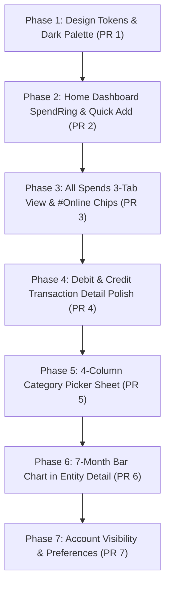

# Axio-Style Expense Tracker: UI Specification & Adaptation Plan

**Version:** 1.0  
**Date:** October 2026  
**Status:** Approved for Implementation  
**Companion Documents:** [SRS.md](file:///Users/krish/Developer/Kharcha/docs/SRS.md), [UI_SPEC.md](file:///Users/krish/Developer/Kharcha/docs/UI_SPEC.md), [TechDoc.md](file:///Users/krish/Developer/Kharcha/docs/TechDoc.md)

---

## 1. Executive Summary & Product Scope

This document specifies the redesign of **Kharcha** adopting the modern, dark-theme, card-based aesthetic of **Axio (formerly Walnut)**, while tailoring it strictly to Kharcha's core mission: **a 100% offline, privacy-first, automated SMS personal expense tracker**.

### Scope Adaptations: Kharcha vs. Axio

Axio includes auxiliary financial products such as personal loans, Buy-Now-Pay-Later (BNPL / "axio Pay Later"), credit lines, and social friend-splitting (Splitwise integration). Kharcha deliberately excludes these to remain a lightweight, secure utility.

| Feature Area | Axio Feature | Kharcha Adaptation (Pure Expense Tracker) |
| :--- | :--- | :--- |
| **Lending & BNPL** | "axio Pay Later", loan applications, credit line dues. | **Excluded completely**. No credit line/loan marketing. The 4th bottom navigation icon represents **Insights / Analytics** or **Settings / Accounts**, not BNPL dues. |
| **Bill Reminders** | Pay later bill payments via payment gateway. | **Local utility bill reminders** parsed from bank/utility SMS, tracked against accounts. |
| **Split with Friends** | Social friend network / Splitwise sync. | **Local share calculation only**: Allows marking an expense as split (e.g. 50% split with roommate) so that only the user's net spend is counted towards their monthly totals. |
| **Accounts** | Linked partner NBFC accounts & credit cards. | **Local Bank & Wallet Accounts**: Accounts detected from SMS sender handles and reference numbers. User can toggle visibility per account with an eye icon. |
| **Privacy & Storage** | Cloud sync and server backup. | **Zero Internet permission**. Everything stays on-device in Room database and encrypted SharedPreferences. |

---

## 2. Global Design System & Tokens

### 2.1 Theme & Color Palette
- **Mode:** Dark only. Soft, rounded, dark-elevation card architecture.
- **Backgrounds:**
  - Screen Background: `#121212` to `#161616`
  - Elevated Card / Surface: `#232323` to `#2A2A2A`
  - Raised Row inside Card: `#2E2E2E`
  - Hairline Dividers: `#333333`
- **Primary & Accent Colors:**
  - **Lime Green Accent (`#A8E04A`)**: Active tab indicator glow, "Set budget" actions, active bottom nav icon, toggles (ON), income icons/arrows.
  - **Pale Lime (`#C8F08F`)**: Fill for primary "+ Add" action pill button with dark text (`#121212`).
  - **Chart Blue (`#4B4FE6`)**: Monthly bar chart columns; selected/current month bar has a lighter highlight.
  - **Account Row Navy (`#1F2D3D`)**: Detail screen bank account pill container.
  - **Online Tag Blue (`#1E293B` container, `#38BDF8` text)**: `#Online` merchant tag badge.
- **Financial Status Colors:**
  - **Income / Credit:** `#4ADE80` (lime/green) with `↙` direction arrow.
  - **Expense / Debit:** `#FB923C` or `#FFFFFF` (depending on card context) with `↗` direction arrow.
  - **Transfer / Reconciled:** `#94A3B8` (blue-grey) with swap icon.
  - **Warning / Exceeded:** `#FBBF24` (warning) and `#F87171` (budget exceeded).
- **Typography:**
  - Rounded geometric sans (`Outfit` or `Google Sans` style) with tabular figures for numbers.
  - Hero Amounts: 40–48sp, medium / bold.
  - Screen Titles: 18sp, semi-bold.
  - List Item Titles: 16sp, medium.
  - Section Labels ("Recent transactions"): 18sp, bold.
  - Subtitles / Timestamps: 12sp, `#9E9E9E`.
- **Shapes & Elevation:**
  - Cards: 16–24dp rounded corners.
  - Buttons and Chips: Fully rounded pill shape (`CircleShape` / 100dp).
  - Tonal elevation without harsh drop shadows.

### 2.2 Micro-Interactions & Feedback
- **Pill Toast:** Bottom-anchored dark pill toast with a small lime green icon for immediate action feedback:
  - *"Will not be counted in total spends"*
  - *"Will be counted in income"*
  - *"Copied to clipboard"*
  - *"Transaction deleted • Undo"*

---

## 3. Navigation Architecture

### 3.1 Bottom Navigation Bar (4 Destinations, Icon-Only)
No text labels; dark container with a subtle top lime glow line above the active destination:
1. **Accounts / Balances** (Wallet / Bank / Card icon): Overview of all accounts, balances, and visibility toggles.
2. **Home / Spends** (Bar chart icon — **Active Default**): Primary dashboard with the 190dp spend ring and recent transactions.
3. **Insights / Trends** (Pie chart / Trends icon): Spending breakdown, category donuts, pacing heatmap, recurring subscriptions.
4. **Settings / More** (Gear icon): SMS rescan, category management, budget settings, CSV export, backup.

### 3.2 Top App Bar Patterns
- **Home:** Circular avatar (40dp) + "Hi [User Name]" on the left, Search icon (`🔍`) and Privacy toggle (`👁`) on the right.
- **Inner Screens:** Back navigation arrow, screen title, month selector dropdown (e.g. `Oct ▾`), and right-side contextual actions (filter funnel, overflow menu).

---

## 4. Screen Specifications

### 4.1 Screen 1: Home Dashboard (`feature:home`)
```
┌─────────────────────────────────────────────────────────────┐
│ (👤) Hi Krishna                              [👁] [🔍 Search]│
├─────────────────────────────────────────────────────────────┤
│                                                             │
│                      Spent in October                       │
│                     ┌─────────────────┐                     │
│                     │     ↗ 65,260    │ (190dp ring gauge)  │
│                     └─────────────────┘                     │
│                                                             │
│         Income ₹0            │      Set monthly budget      │
│     (or total credits)       │       (or ₹30,000 left)      │
│                                                             │
│         [ 📊 Trends ]                [ 🥧 Categories ]      │
│                                                             │
│ ┌─────────────────────────────────────────────────────────┐ │
│ │ Recent transactions                       [ + Add pill ]│ │
│ │                                                         │ │
│ │ [ 🛒 ] Swiggy                      ↗ ₹450  Today, 9:46 pm│ │
│ │ [ ⚡ ] BESCOM                    ↗ ₹1,200         24 Oct │ │
│ │ [ 💰 ] Salary Received          ↙ ₹85,000         01 Oct │ │
│ └─────────────────────────────────────────────────────────┘ │
└─────────────────────────────────────────────────────────────┘
```
- **Spent Ring Gauge:** 190dp circular ring. Thin grey track when no budget is set; dynamically fills with lime-to-amber progress as expenses approach the budget. Center displays direction arrow (`↗`) and large spent amount. **Tapping the ring navigates directly to All Spends.**
- **Sub-Ring Columns:**
  - Left column: "Income" label with total credits formatted (e.g. `₹85,000`).
  - Right column: "Set monthly budget" CTA with circular blue icon (or remaining balance if budget is set). Tapping opens the budget setter.
- **Shortcut Pills:** Dark pills with lime text navigating to deep views:
  - `[ 📊 Trends ]` -> Opens monthly comparison and pacing charts.
  - `[ 🥧 Categories ]` -> Opens category breakdown donut view.
- **Recent Transactions Card:** Elevated dark card (`#232323`) containing:
  - Header: "Recent transactions" on left, pale-lime `+ Add` pill button on right.
  - Rows: Category icon in tinted rounded square, merchant name (ellipsized), amount with `↗`/`↙`, and timestamp ("Today, 9:46 pm" or "24 Oct"). Tapping opens Transaction Detail.

---

### 4.2 Screen 2: All Spends (`feature:transactions`)
A dedicated 3-tab screen for in-depth spend exploration:
- **Top App Bar:** Back arrow, "All spends" title with month dropdown (`Oct ▾`), chat/tags icon, filter funnel icon, and export icon.
- **Tab Header:** 3 equal-width tabs: `Transactions` · `Categories` · `Merchants`. Active tab highlighted with lime green text and a glowing underline indicator.
- **Tab 1: Transactions**
  - Hero Month Ring summary block at top.
  - Flat list of debit rows.
  - Known online merchants (Swiggy, Blinkit, Amazon, etc.) display a small blue `#Online` tag chip.
- **Tab 2: Categories**
  - Donut chart (220dp) with color-coded slices. Tapping a slice highlights and offsets it.
  - Right-side vertical legend: Color dot + `Category Name %` (e.g. `Shopping 42.7%`).
  - Summary row below chart: `Spends ₹65,260` on the left, `Set monthly budget` on the right.
  - Ranked category cards (sorted by spend descending): Category icon, name, `N Spends`, amount on right, and a lime `Set budget ›` link. Tapping a card opens the category detail list.
- **Tab 3: Merchants**
  - Ranked merchants list sorted by total spend descending.
  - Each item: Merchant icon (green rounded square), name, `N Spend(s)` subtitle, and total amount. Encapsulated in a single dark card.

---

### 4.3 Screen 3: Merchant & Category Detail (`feature:transactions`)
Used when drilling down into a specific merchant or category:
- **Header:** Merchant/Category name with month dropdown under it (`Vijetha Super Markets Pvt • Oct ▾`).
- **7-Month Bar Chart:**
  - Displays last 7 months as vertical rounded bars in blue (`#4B4FE6`).
  - Value labels above each bar (e.g. `1.0K`, `518`, `782`).
  - Month initials below (`Apr`, `May`, `Jun`, `Jul`, `Aug`, `Sep`, `Oct`).
  - Current month highlighted with a lighter column color.
  - Chart scrolls horizontally to view historical trends.
- **Transaction List:** List of all transactions matching this merchant or category in the selected timeframe.

---

### 4.4 Screen 4: Debit Transaction Detail (`feature:transactions`)
```
┌─────────────────────────────────────────────────────────────┐
│ [←] Debit transaction                                   [⋮] │
├─────────────────────────────────────────────────────────────┤
│ ┌─────────────────────────────────────────────────────────┐ │
│ │ Vijetha Super Markets Pvt ›              [ 118 visits 📊 ]│ │
│ │                                                         │ │
│ │                         ↗ ₹61.81                        │ │
│ │                     [ 🛒 Groceries ]                    │ │
│ │                                                         │ │
│ │                     Today, 9:46 PM                      │ │
│ └─────────────────────────────────────────────────────────┘ │
│                                                             │
│ ┌─────────────────────────────────────────────────────────┐ │
│ │ [🏦] HDFC ••1999                    Expense [ Toggle ON ]│ │
│ └─────────────────────────────────────────────────────────┘ │
│                                                             │
│ ┌─────────────────────────────────────────────────────────┐ │
│ │ [📝] Notes                                  Tap to add  │ │
│ └─────────────────────────────────────────────────────────┘ │
│                                                             │
│ ┌───────────────────────────┐ ┌───────────────────────────┐ │
│ │ [👥] Split expense        │ │ [📷] Attach receipt       │ │
│ │ Deduct shared share       │ │ Add photo proof / warranty│ │
│ │              [ Split pill]│ │             [ Attach pill]│ │
│ └───────────────────────────┘ └───────────────────────────┘ │
│                                                             │
│ ┌─────────────────────────────────────────────────────────┐ │
│ │ [🏷️] Tags                                            [+]│ │
│ └─────────────────────────────────────────────────────────┘ │
│                                                             │
│ ┌─────────────────────────────────────────────────────────┐ │
│ │ Other info                                              │ │
│ │ Location: See map [📍]                                  │ │
│ │ Ref No: UPI/42981293812                                 │ │
│ │ SMS: "Paid Rs 61.81 to Vijetha..." (Tap to copy)        │ │
│ └─────────────────────────────────────────────────────────┘ │
└─────────────────────────────────────────────────────────────┘
```
1. **Hero Card (Green Tinted Surface):**
   - Top-left: Underlined merchant name, tapping navigates to Merchant Detail.
   - Top-right: Visit count pill (`118 visits 📊`).
   - Center: `↗` glyph + large amount (`₹61.81`).
   - Category Chip: Clickable pill (`[ 🛒 Groceries ]`) opening the category picker sheet.
   - Timestamp: Centered at bottom.
2. **Account Row (Dark Navy `#1F2D3D`):**
   - Bank icon, account name/digits (`HDFC ••1999`).
   - "Expense" label with switch. Toggling OFF excludes transaction from totals and displays toast: *"Will not be counted in total spends"*.
3. **Notes Card:** Note icon, "Notes" label, and "Tap to add" inline editor.
4. **Side-by-Side Action Cards:**
   - Left: **Split expense card** — calculates user's share vs friends' share locally so net totals stay accurate.
   - Right: **Attach receipt card** — launches photo picker or shows attached receipt thumbnail with fullscreen dialog.
5. **Tags Row:** Tag icon, "Tags", and `+` button to manage custom tags.
6. **Other Info Card:** Location pin, Reference Number, and complete raw SMS text. Tapping or long-pressing copies SMS to clipboard with toast: *"Copied to clipboard"*.

---

### 4.5 Screen 5: Credit Transaction Detail (`feature:transactions`)
Same foundation as Debit Detail, with specialized credit behavior:
- **Title:** "Credit transaction" with `↙` glyph.
- **Account Row Toggle:** "Income" label (default OFF or ON based on classification). Toggling ON triggers toast: *"Will be counted in income"*.
- **Linked Expense Row:** For refund transactions, displays the counterpart debit transaction:
  - Circular green icon, title `"Refund for Swiggy"`, amount `₹450`, and a Link/Unlink button.
- **Split Card:** Disabled with notice: *"Split not available for credit transactions"*.

---

### 4.6 Screen 6: Category Picker Bottom Sheet
- Full-height bottom sheet with close `✕` button and "Categories" title.
- **4-Column Grid:** Round category icon + label below.
- **Two Semantic Groups:**
  1. **"Mark as income"**: Bank Deposit, Business, Interest, Salary.
  2. **"Mark as not an income"**: A/C Transfer, Bill Payment, Credit, Investment, Loan, Recharge, Refund, Reimbursement, Rewards.
- **Selection State:** Active category gets a `#A8E04A` lime border.
- **Footer Card:** Explains selected category behavior:
  - Title: *"Will not be counted in income"* (or will be counted).
  - Toggle switch: *"Mark as income"*.
  - Description: *"Transactions categorized with this category will be counted as income."*

---

### 4.7 Screen 7: Account Settings & Preferences (`feature:settings`)
Clean, card-based settings architecture tailored for offline expense tracking:
- **Account Summary Card:**
  - Displays user profile name and email with a lime "Edit" link.
- **Manage Accounts (`feature:accounts`):**
  - List of detected banks, cards, and wallets.
  - Each row: Bank logo, account name, last 4 digits, and an **eye icon toggle** (`👁`) to include/exclude the account from total calculations.
- **Preferences Group:**
  - Spend Categories (Add / Delete / Reorder).
  - Credit Categories (Add / Delete / Reorder).
  - Tags Manager.
  - Transfer Threshold (e.g. `₹10,000` auto-classify as transfer).
  - Bill & Spend Reminders (Notification timing, smart spend alerts).
  - Rescan SMS Inbox (re-runs parser on stored SMS).
  - Export Statement (CSV / JSON bottom dialog).
  - Backup & Security (Encrypted local export).

---

## 5. Technical Implementation Guidelines

Per Kharcha's architecture and `AGENTS.md`:
1. **Currency Handling:** Always store and compute amounts as **`Long` minor units (paise)**. Never use `Double` or `Float`.
2. **Privacy & Security:**
   - No `INTERNET` permission in `AndroidManifest.xml`.
   - Never log SMS bodies, account numbers, or amounts in logcat.
   - Passwords and encryption keys stay in Android KeyStore.
3. **Strings & Colors:**
   - Zero hard-coded hex colors in Composables. All colors must reference `MaterialTheme.colorScheme` or `MaterialTheme.financialColors`.
   - Zero hard-coded user-facing strings; all strings must reside in `strings.xml`.
4. **Code Quality:**
   - Small, targeted PRs under ~600 changed lines.
   - Run `./gradlew ktlintCheck detekt test` prior to submitting code.

---

## 6. Phased Implementation Roadmap



### Phase 1: Core Design System Tokens & Base Theme (PR 1)
- Add Axio color palette to `Color.kt` and `FinancialThemeTokens.kt`.
- Enforce dark surface architecture and 20–24dp card corner styling.
- Create `KharchaPillToast` component with green icon and auto-dismiss.
- Update bottom navigation bar in `MainActivity.kt` to 4 icon-only items with lime top glow.

### Phase 2: Home Dashboard Redesign (PR 2)
- Build 190dp `SpendRing` gauge component.
- Implement Axio-style `HomeScreen`:
  - Avatar + "Hi Krishna" header.
  - "Spent in [Month]" label and `SpendRing`.
  - Income & "Set monthly budget" split columns.
  - "Trends" & "Categories" shortcut pills.
  - Recent transactions card with pale lime `+ Add` button.
- Wire navigation: Ring -> All Spends, + Add -> Manual entry dialog.

### Phase 3: All Spends 3-Tab Experience (PR 3)
- Refactor `TransactionsScreen` into 3 swipeable tabs: `Transactions` · `Categories` · `Merchants`.
- Style tab bar with lime text and glowing underline.
- Add blue `#Online` merchant tags.
- Update Categories tab with 220dp donut chart, right legend, and category cards with `Set budget ›`.
- Update Merchants tab with ranked spend cards.

### Phase 4: Debit & Credit Transaction Detail (PR 4)
- Restyle `TransactionDetailScreen`:
  - Green-tinted hero card with visits pill.
  - Dark navy `#1F2D3D` account pill with instant Expense/Income toggle and toast feedback.
  - Side-by-side local Split and Attach Receipt cards.
  - Other info card with tap-to-copy SMS toast.
- Implement dedicated Credit mode with linked refund counterpart row.

### Phase 5: 4-Column Category Picker Sheet (PR 5)
- Build 4-column modal category picker.
- Separate into "Mark as income" vs "Mark as not an income" groups.
- Lime selection border and bottom explanation card with toggle.

### Phase 6: 7-Month Rounded Bar Chart (PR 6)
- Update `EntityTransactionsScreen` bar chart with 7 rounded vertical bars in `#4B4FE6` blue.
- Add above-bar shortened value labels (`1.0K`) and highlighted current month column.

### Phase 7: Account Settings & Preferences (PR 7)
- Redesign `MoreScreen` with profile header and preference rows.
- Build `ManageAccountsScreen` with eye icon visibility toggles.
- Add `ExportStatementDialog` with pale lime button.
