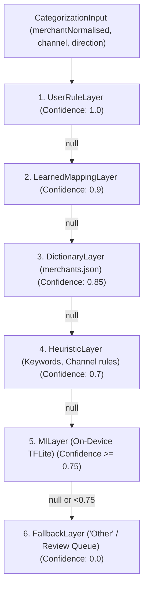

# On-Device ML Merchant Categorizer Plan (MlLayer)

## 1. Overview & Constraints

The `MlLayer` provides machine-learning-based fallback categorisation for unseen or noisy merchant descriptions when exact user rules, learned mappings, dictionary lookups, and regex heuristics do not match.

Per Kharcha's strict privacy and performance requirements:
- **100% On-Device & Offline**: Kharcha does not possess the `INTERNET` permission. The model and tokenizer must execute locally on the device CPU.
- **Model Size**: Must remain below 2 MB (INT8 dynamic range quantized TFLite).
- **Execution Speed**: Must infer in under 5 ms on modern mobile CPUs to keep SMS ingestion responsive.
- **Privacy Guarantee**: Only the normalized merchant string is evaluated; full SMS bodies, amounts, and account numbers are never passed to the ML layer.
- **Confidence Gating**: The model output is accepted only if the top predicted category confidence is $\ge 0.75$. Lower confidence predictions pass through to `FallbackLayer` ("Other") and land in the Review Queue.

---

## 2. Pipeline Integration

In `CategorizationPipeline`, layers execute in strict priority:



---

## 3. Recommended Architecture: Character N-Gram + Dense Classifier

Indian bank SMS narratives feature short, noisy, and truncated strings (`AMZN*MKTP`, `SWIGGY BANGALORE`, `CHAI PT`, `IRCTC APP`). Character n-grams (2 to 4 characters) perform significantly better than word-level tokenizers because they are resilient to prefixes, typos, and abbreviations without requiring huge vocabulary embeddings.

### Architecture
- **Input**: Raw / normalized merchant text (string)
- **Vectorization**: Character n-grams (2-grams and 3-grams, vocabulary size = 3,000, output = count vector)
- **Hidden Layer**: Dense(64, activation='relu') + Dropout(0.2)
- **Output Layer**: Dense(num_categories, activation='softmax')
- **Quantization**: INT8 Post-Training Dynamic Range Quantization

---

## 4. Model Training & Export Script (Python)

Save this script under `tools/ml/train_categorizer.py`:

```python
import json
import numpy as np
import tensorflow as tf

# 1. Dataset of (merchant_name, category)
# Expand with real anonymized merchant corpus and synthetic variations
data = [
    # Food & Dining
    ("swiggy", "Food & Dining"),
    ("swiggy order", "Food & Dining"),
    ("zomato", "Food & Dining"),
    ("zomato delivery", "Food & Dining"),
    ("chai point", "Food & Dining"),
    ("starbucks", "Food & Dining"),
    ("mcdonalds", "Food & Dining"),
    ("kfc store", "Food & Dining"),
    ("dominos pizza", "Food & Dining"),
    ("burger king", "Food & Dining"),
    # Groceries
    ("blinkit", "Groceries"),
    ("zepto", "Groceries"),
    ("instamart", "Groceries"),
    ("bigbasket", "Groceries"),
    ("dmart", "Groceries"),
    ("reliance fresh", "Groceries"),
    # Transport
    ("uber", "Transport"),
    ("uber trip", "Transport"),
    ("ola cabs", "Transport"),
    ("rapido", "Transport"),
    ("hpcl petrol pump", "Transport"),
    ("bpcl fuel", "Transport"),
    ("irctc", "Transport"),
    # Shopping
    ("amazon", "Shopping"),
    ("amazon seller", "Shopping"),
    ("flipkart internet", "Shopping"),
    ("myntra designs", "Shopping"),
    ("ajio retail", "Shopping"),
    ("tata cliq", "Shopping"),
    # Bills & Utilities
    ("airtel prepaid", "Bills & Utilities"),
    ("jio recharge", "Bills & Utilities"),
    ("bescom electricity", "Bills & Utilities"),
    ("tata power", "Bills & Utilities"),
    ("adani gas", "Bills & Utilities"),
    # Entertainment
    ("netflix", "Entertainment"),
    ("spotify india", "Entertainment"),
    ("bookmyshow", "Entertainment"),
    ("pvr cinemas", "Entertainment"),
    # Health
    ("apollo pharmacy", "Health"),
    ("1mg healthcare", "Health"),
    ("pharmeasy", "Health"),
    ("medplus", "Health"),
    # Investments
    ("zerodha broking", "Investments"),
    ("groww invest", "Investments"),
    ("indmoney", "Investments"),
    ("upstox", "Investments"),
]

merchants = [item[0] for item in data]
categories = [item[1] for item in data]
unique_categories = sorted(list(set(categories)))
cat_to_id = {cat: idx for idx, cat in enumerate(unique_categories)}
y = np.array([cat_to_id[cat] for cat in categories])

# 2. Text Vectorization (Char N-Grams)
vectorizer = tf.keras.layers.TextVectorization(
    max_tokens=3000,
    split="character",
    ngrams=(2, 3),
    output_mode="count",
)
vectorizer.adapt(merchants)

# 3. Model Definition
model = tf.keras.Sequential([
    vectorizer,
    tf.keras.layers.Dense(64, activation="relu"),
    tf.keras.layers.Dropout(0.2),
    tf.keras.layers.Dense(len(unique_categories), activation="softmax"),
])

model.compile(
    optimizer="adam",
    loss="sparse_categorical_crossentropy",
    metrics=["accuracy"],
)

model.fit(merchants, y, epochs=30, batch_size=16)

# 4. Quantized TFLite Conversion
converter = tf.lite.TFLiteConverter.from_keras_model(model)
converter.optimizations = [tf.lite.Optimize.DEFAULT]
tflite_model = converter.convert()

with open("merchant_categorizer.tflite", "wb") as f:
    f.write(tflite_model)

with open("labels.json", "w") as f:
    json.dump(unique_categories, f)

print(f"Model exported: {len(tflite_model)} bytes")
```

Target Asset Placement:
- `merchant_categorizer.tflite` $\rightarrow$ `engine/categorizer/src/main/assets/models/merchant_categorizer.tflite`
- `labels.json` $\rightarrow$ `engine/categorizer/src/main/assets/models/labels.json`

---

## 5. Android Engine Implementation (`MlLayer.kt`)

### 1. Build Dependencies (`engine/categorizer/build.gradle.kts`)
```kotlin
dependencies {
    implementation("org.tensorflow:tensorflow-lite:2.14.0")
}
```

### 2. Implementation Class
```kotlin
package com.kharcha.engine.categorizer

import android.content.Context
import com.kharcha.core.model.CategorizationInput
import com.kharcha.core.model.CategorizationResult
import org.tensorflow.lite.Interpreter
import java.io.FileInputStream
import java.nio.channels.FileChannel

class MlLayer(
    private val context: Context,
    private val confidenceThreshold: Float = 0.75f,
) : CategorizationLayer {

    override val name: String = "ML"

    private val interpreter: Interpreter? by lazy {
        try {
            val assetFd = context.assets.openFd("models/merchant_categorizer.tflite")
            val inputStream = FileInputStream(assetFd.fileDescriptor)
            val modelBuffer = inputStream.channel.map(
                FileChannel.MapMode.READ_ONLY,
                assetFd.startOffset,
                assetFd.declaredLength,
            )
            Interpreter(modelBuffer)
        } catch (_: Throwable) {
            null
        }
    }

    private val labels: List<String> by lazy {
        try {
            val json = context.assets.open("models/labels.json").bufferedReader().use { it.readText() }
            val array = org.json.JSONArray(json)
            (0 until array.length()).map { array.getString(it) }
        } catch (_: Throwable) {
            emptyList()
        }
    }

    override suspend fun categorize(input: CategorizationInput): CategorizationResult? {
        val tflite = interpreter ?: return null
        if (labels.isEmpty()) return null

        val merchant = input.merchantNormalised ?: input.merchantRaw ?: return null
        if (merchant.isBlank()) return null

        val outputProbabilities = Array(1) { FloatArray(labels.size) }
        val inputData = arrayOf(merchant)

        try {
            tflite.run(inputData, outputProbabilities)
        } catch (_: Throwable) {
            return null
        }

        val probabilities = outputProbabilities[0]
        var maxIndex = 0
        var maxProb = 0f
        for (i in probabilities.indices) {
            if (probabilities[i] > maxProb) {
                maxProb = probabilities[i]
                maxIndex = i
            }
        }

        if (maxProb < confidenceThreshold) {
            return null
        }

        return CategorizationResult(
            category = labels[maxIndex],
            subcategory = null,
            confidence = maxProb,
            source = name,
        )
    }
}
```

---

## 6. Feedback & Learning Loop

1. **User Corrections Take Precedence**: When a user changes an ML-assigned category in the Review Queue or Transaction Detail screen, a `MerchantMapping` is created. Future transactions from that merchant immediately match `LearnedMappingLayer` (confidence 0.9) and bypass the ML layer.
2. **Review Queue Safety**: Any ML inference scoring below 0.75 confidence is marked Unreviewed / Needs Review, preventing inaccurate automated categorization from polluting financial analytics.
3. **Model Retraining**: The local user rule and mapping database can be exported as an anonymized training corpus to periodic model updates in subsequent app releases.
