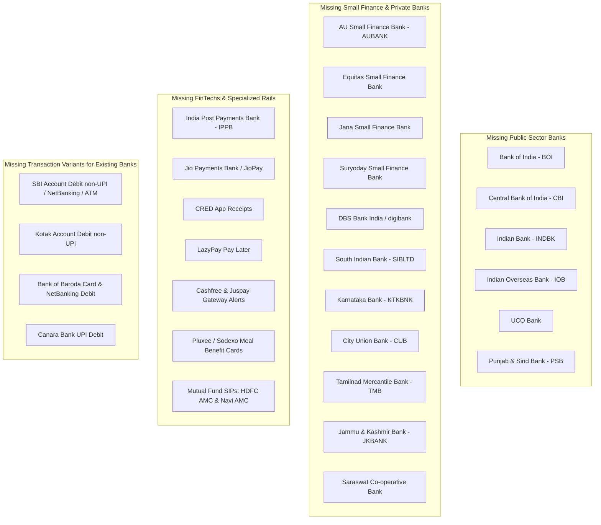
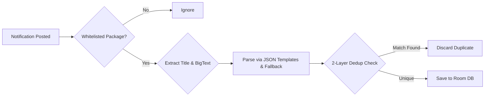

# Indian Banking SMS Parser Benchmark & Comprehensive Enhancement Plan

## 1. Executive Summary

This document consolidates findings from an exhaustive codebase walkthrough of two premier open-source offline expense trackers:
1. **[allwin-antony/Expense_tracker](https://github.com/allwin-antony/Expense_tracker)**: A Dart/Flutter privacy-first tracker featuring an on-device quantized **FastText classifier**, **Clause Semantic Scoper**, and multi-signal authenticity validation.
2. **[sarim2000/pennywiseai-tracker](https://github.com/sarim2000/pennywiseai-tracker)**: A Kotlin Multiplatform (KMP) & Jetpack Compose application featuring hardcoded parsers for **140+ financial institutions**, **NotificationListenerService**, **PDF statement parsing**, and local **LiteRT-LM** SLM execution.

### Architectural Comparison

| Dimension | `Expense_tracker` | `pennywiseai-tracker` | `Kharcha` |
| :--- | :--- | :--- | :--- |
| **Financial Arithmetic** | `double` (floating point) | `BigDecimal` (in `Money.kt` with currency isolation) | **Strict `Long` minor units (paise)** |
| **Parsing Strategy** | Multi-tier NLP: FastText classifier + Clause Scoper + Regex | Factory Pattern: hardcoded Kotlin classes (`BankParserFactory`) | **Declarative JSON templates** + `GenericFallbackParser` |
| **Spam & OTP Filtering** | Quantized on-device FastText ML (~171.5 KB, <0.3 ms) | Regex patterns in `CompiledPatterns.kt` & bank classes | Heuristic regex in `NoiseFilter.kt` |
| **Balance Conflation** | **Clause Semantic Scoper**: isolates action clause from balance clauses | Regex ordering & negative lookaheads per bank | Regex named groups in JSON templates |
| **Ingestion Triggers** | SMS Inbox sync + interactive clipboard/manual paste | SMS Receiver + WorkManager + **NotificationListenerService** | SMS Receiver + WorkManager batch import |
| **Historical Ingestion** | SMS Inbox ContentResolver | SMS Inbox + **Password-protected PDF Bank Statements** | SMS Inbox ContentResolver |
| **Privacy & Security** | **Public Privacy Mode** (one-tap masking) | 100% offline, zero cloud calls, SAF document exports | SQLCipher encrypted Room DB, 100% offline |
| **On-Device AI** | Pure-Dart FastText neural classifier + BERT tokenizer | **Google LiteRT-LM** (`litertlm-android`) running local Qwen 2.5 | TFLite `MlLayer` planned for merchant categorization |

Kharcha already possesses the strongest financial data foundation: **strict `Long` integer minor units** (preventing floating-point drift) and **declarative JSON templates** (allowing bank regex updates without compiling Kotlin code). 

However, PennyWise has significantly wider **Indian banking institution coverage** and advanced ingestion (push notifications + PDF statements), while Allwin Antony's tracker solves balance-conflation and spam resilience via **Clause Semantic Scoping** and **Subword ML**.

---

## 2. Indian Bank Parser Coverage Audit

### 2.1 Current Coverage in Kharcha (`engine/parser/src/main/assets/templates/`)
Kharcha currently contains 40 JSON templates covering:
- **Tier-1 Banks**: HDFC (UPI, Card, Account, Credit), ICICI (UPI v1/v2, Card v1/v2, Debit, Credit), SBI (UPI, Credit), Axis (UPI, Card, Credit), Kotak (UPI, Credit).
- **Public Sector Banks**: PNB (Debit, UPI), Bank of Baroda (UPI), Canara Bank (Debit), Union Bank (Debit).
- **Private Sector Banks**: IDFC First (UPI, Card, Refund), IndusInd (Debit), Federal Bank (Debit), Yes Bank (Debit), Standard Chartered (Card).
- **FinTechs & Cards**: OneCard, Slice, Jupiter, Fi Money, Airtel Payments Bank, Paytm UPI, Amex Card.
- **Generic / Rails**: ATM withdrawals, Credit Card spend generic, NEFT credit.

### 2.2 Coverage Gap Analysis Against PennyWise AI (140+ Institutions)
PennyWise contains specialized parsers for **54+ Indian banking institutions and FinTechs**. The following institutions are missing or incomplete in Kharcha:



### 2.3 Detailed Bank Specifications to Add

| # | Bank / Institution | Sender Headers | Sample SMS Format | Key Extracted Fields |
|---|--------------------|----------------|-------------------|----------------------|
| 1 | **Bank of India (BOI)** | `BOITXN`, `BOIIND` | `Your A/C XXXXX1234 is debited for Rs 850.00 on 24-10-2026 by UPI/6291.../Zomato. Avl Bal Rs 14,250.00` | Amount, Last4, Ref (UTR), Merchant, Balance |
| 2 | **Central Bank of India (CBI)** | `CBISMS`, `CENTBK` | `A/c *1234 debited by Rs.1,200.00 on 24/10/2026 through UPI:629182... to user@okhdfcbank. Bal: Rs.5,400.00` | Amount, Last4, UPI ID, Ref, Balance |
| 3 | **Indian Bank** | `INDBNK`, `INDIAN` | `Dear Customer, A/c no. ending 1234 is debited by Rs. 450.00 on 24-10-2026. Ref: 429182... Bal: Rs 8,100` | Amount, Last4, Ref, Balance |
| 4 | **Indian Overseas Bank (IOB)** | `IOBCHN`, `IOBTXN` | `Your a/c no. XX1234 debited by Rs 320.00 on 24-10-2026. Info: Swiggy. Available Bal Rs 4,500.00` | Amount, Last4, Merchant, Balance |
| 5 | **UCO Bank** | `UCOBNK`, `UCOSMS` | `A/C XX1234 debited by Rs. 2,500.00 on 24-10-2026. Info: NEFT/AXISN... Bal Rs. 18,200.00` | Amount, Last4, Channel, Balance |
| 6 | **Punjab & Sind Bank (PSB)** | `PSBSMS`, `PUNBNK` | `A/c XX1234 debited for Rs. 500.00 on 24-10-2026 towards UPI/429182.../Merchant. Avl Bal Rs. 3,200` | Amount, Last4, Ref, Merchant, Balance |
| 7 | **AU Small Finance Bank** | `AUBANK` | `Rs. 1,499.00 spent on AU Bank Debit Card ending 1234 at RELIANCE RETAIL on 24-Oct-26. Avail Bal: Rs 42,100` | Amount, Card Last4, Merchant, Date, Balance |
| 8 | **Equitas Small Finance Bank** | `EQUTAS`, `EQUITB` | `A/c XX1234 debited for Rs 750.00 on 24-10-2026 via UPI Ref 429182... Avl Bal: Rs 12,300` | Amount, Last4, UPI Ref, Balance |
| 9 | **South Indian Bank (SIB)** | `SIBLTD`, `SOINBK` | `A/c XX1234 debited by Rs 2,000.00 on 24-Oct-2026 towards ATM-CASH WDL. Balance: Rs 15,000.00` | Amount, Last4, Channel (ATM), Balance |
| 10 | **Karnataka Bank** | `KTKBNK`, `KARBNK` | `Your A/C ...1234 is debited for Rs 650.00 on 24-10-2026 by UPI to SWIGGY. Avail Bal Rs 6,400.00` | Amount, Last4, Merchant, Balance |
| 11 | **City Union Bank (CUB)** | `CUBTXN`, `CITYUB` | `A/c XX1234 debited Rs. 800.00 on 24-10-2026 via UPI Ref 4291... Avl Bal Rs. 22,000` | Amount, Last4, Ref, Balance |
| 12 | **Tamilnad Mercantile Bank** | `TMBANK`, `TMBNKL` | `A/c XX1234 debited by Rs 350.00 on 24/10/26. Info: POS SWIPE at PETROL BUNK. Bal Rs 4,100` | Amount, Last4, Merchant, Balance |
| 13 | **Jammu & Kashmir Bank (J&K)** | `JKBANK` | `Your A/c XX1234 debited by Rs 1,100.00 on 24-10-2026. Transfer to XYZ. Bal: Rs 9,000.00` | Amount, Last4, Merchant, Balance |
| 14 | **India Post Payments Bank** | `IPPOPB`, `IPPBIN` | `Rs 400.00 debited from IPPB A/c XX1234 on 24-10-2026 by UPI/4291... to merchant@upi. Avl Bal Rs 1,200` | Amount, Last4, UPI ID, Balance |
| 15 | **Jio Payments Bank** | `JIOPAY`, `JIOPB` | `Rs 199.00 debited from Jio Payments Bank A/c ...1234 on 24-Oct-2026 for JIO RECHARGE. Bal: Rs 540` | Amount, Last4, Merchant, Balance |
| 16 | **CRED** | `CREDCL`, `DREAMPLUG` | `Payment of Rs 14,500 to HDFC Credit Card ending 1234 successful via CRED. UTR: 4291823...` | Amount, Card Last4, Merchant, Ref |
| 17 | **Pluxee / Sodexo** | `PLUXEE`, `SODEXO` | `Spent Rs. 420.00 on Pluxee Card 1234 at SWEET DREAMS on 24-Oct-26. Remaining card balance: Rs 1,840.00` | Amount, Card Last4, Merchant, Balance |
| 18 | **Mutual Fund SIPs (HDFC/Navi)** | `HDFCAMC`, `NAVAMC` | `SIP installment of Rs 2,000.00 successfully processed for HDFC Top 100 Fund. Folio: 12345/67` | Amount, Fund Name (Merchant), Channel |
| 19 | **SBI Account Debit (NetBanking/ATM)** | `SBINB`, `ATMSBI`, `SBIINB` | `Dear SBI Customer, A/c X1234 debited by Rs 5,000.00 on 24Oct26 through ATM cash wdl. Bal: Rs 24,150.00` | Amount, Last4, Channel, Balance |
| 20 | **Kotak NetBanking/Card Debit** | `KOTAKB`, `KOTAK` | `Sent Rs. 3,500.00 from Kotak Bank A/c XX1234 to XYZ on 24-Oct-2026. Net Banking Ref 123456. Bal: Rs 41,000` | Amount, Last4, Merchant, Channel, Balance |

---

## 3. High-Value Parsing Engine Upgrades for Kharcha

### 3.1 Clause Semantic Scoping (`ClauseSemanticScoper.kt`)
In multi-sentence Indian bank SMS messages, available balances or credit limits frequently precede or follow transaction amounts. To guarantee zero false amount extractions in `GenericFallbackParser` and pre-processing:

```kotlin
package com.kharcha.engine.parser

object ClauseSemanticScoper {
    private val BALANCE_KEYWORDS = Regex(
        """\b(?:passbook\s*balance|available\s*balance|avl\s*bal|account\s*balance|total\s*balance|remaining\s*balance|ledger\s*balance|updated\s*balance|net\s*balance|clear\s*bal|available\s*limit|avail\s*limit|avail\s*lmt|limit\s*available)\b""",
        RegexOption.IGNORE_CASE
    )

    private val TRANSACTION_KEYWORDS = Regex(
        """\b(?:debited|spent|paid|withdrawn|transferred|sent|charged|deducted|credited|deposited|received|refunded|salary|contribution|disbursed)\b""",
        RegexOption.IGNORE_CASE
    )

    // Splits into clauses while preserving decimal currency (Rs. 100.50) and account numbers (A/c. 123)
    private val CLAUSE_SPLITTER = Regex(
        """(?<!\bRs|\bINR|\bRe|\bdr|\bmr|\bms|\bA\/c|\bNo)(?:\/|\-|\w{2,})\.\s+(?=[A-Z])|;\s*|\n+"""
    )

    fun isolateTransactionClause(rawSms: String): String {
        val clean = rawSms.replace("\r\n", "\n").replace("\r", "\n").trim()
        val clauses = clean.split(CLAUSE_SPLITTER).map { it.trim() }.filter { it.isNotEmpty() }
        if (clauses.size <= 1) return clean

        val txnClauses = clauses.filter { clause ->
            val hasTxn = TRANSACTION_KEYWORDS.containsMatchIn(clause)
            val isBalance = BALANCE_KEYWORDS.containsMatchIn(clause)
            hasTxn && (!isBalance || clause.contains("debited", ignoreCase = true) || clause.contains("credited", ignoreCase = true))
        }

        return if (txnClauses.isNotEmpty()) {
            txnClauses.joinToString(". ")
        } else {
            clauses.filterNot { BALANCE_KEYWORDS.containsMatchIn(it) }.joinToString(". ")
        }
    }
}
```

### 3.2 Indian Banking Edge Case Normalization
Adopt the battle-tested parsing rules observed in PennyWise:

1. **Bill Payments Misclassified as Income**:
   - SMS: *"Payment of Rs. 1,499 received from your SBI Card XX1234 for Airtel Broadband"*.
   - Keyword *"received"* triggers `Direction.CREDIT` in standard fallback parsers.
   - **Fix**: Check `RegExp(r'received\s+from\s+(?:your|the)\s+(?:debit\s*card|credit\s*card|a/c)', IGNORE_CASE)` to enforce `Direction.DEBIT`.
2. **HDFC Reversal Whitespace Padding**:
   - HDFC pads merchant names with spaces before internal branch codes: `By AMAZON        000 On 2026-08-21`.
   - **Fix**: Match `\bBy\s+(.+?)(?:\s{2,}|\s+On\s)` and strip trailing codes.
3. **UPI QR Suffix Stripping**:
   - When extracting merchant handles from VPAs (`paytmqr123@paytm`, `merchantqr@icici`), remove trailing `qr` or `qr\d+` to yield clean merchant names (`Paytm Merchant`).
4. **Missing Year Resolution**:
   - When templates extract timestamps lacking years (e.g. `24-Oct at 14:30`), bind them to `sms.receivedAt`. If the resulting date is $>2$ days in the future, roll back to `receivedAt.year - 1`.

---

## 4. Advanced Ingestion Architecture

### 4.1 Real-Time Push Notification Ingestion (`NotificationListenerService`)
Carrier SMS delivery through telecom DLT scrubbing centers often introduces 2–10 minute lags. Integrating an optional `BankNotificationListenerService` into `:engine:sms` captures payments instantly from payment apps:



#### Two-Layer Cross-Channel Deduplication Algorithm
1. **Layer 1 (Exact Hash)**: Check whether the incoming notification body hash matches an existing transaction hash.
2. **Layer 2 (Time-Window Match)**: If parsed amount, merchant, and bank match any transaction recorded within a **$\pm 2$-minute window** (`timestamp - 120_000L .. timestamp + 120_000L`), discard the notification as a duplicate of the SMS (or vice-versa).

### 4.2 Password-Protected PDF Bank Statement Parser
To ingest full transaction histories directly from official bank e-statements:
1. Use `com.tom-roush:pdfbox-android` for offline text extraction.
2. Securely prompt the user in memory for the password (typically PAN + DOB or Date of Birth) without persisting it.
3. **Running Balance Differential Algorithm**:
   Since tabular column coordinates are lost during raw PDF text stripping, determine debit vs credit from the running balance:
   $$\Delta = \text{Balance}_n - \text{Balance}_{n-1}$$
   - If $\Delta = -\text{Amount} \implies \textbf{DEBIT}$
   - If $\Delta = +\text{Amount} \implies \textbf{CREDIT}$

---

## 5. UI/UX Feature Enhancements

### 5.1 Public Privacy Mode (Peek / Masking)
Inspired by Allwin Antony's tracker:
- Add a global `isPublicPrivacyMode: StateFlow<Boolean>` in `:core:preferences`.
- Add an eye-slash icon button in the TopAppBar of `HomeScreen` and `TransactionsScreen`.
- When toggled, all currency displays render as `••••••` or blurred text tokens, allowing users to comfortably browse Kharcha in public transit or shared office environments.

### 5.2 User-Configurable Merchant Override Rules
- Allow users to create custom mapping rules in `:feature:settings`:
  * *Condition*: If merchant contains `SWEET BENGAL` or `SWIGGY*`
  * *Action*: Clean merchant name to `Sweet Bengal` and assign category to `Food & Dining`.
- Stored locally in Room (`merchant_rules` table) and evaluated with priority $1.0$ before fallback categorization.

---

## 6. Prioritized Implementation Roadmap

### Milestone 1: Engine Resilience & Clause Semantic Scoping
- [ ] Add `ClauseSemanticScoper.kt` to `engine:parser`.
- [ ] Integrate `ClauseSemanticScoper.isolateTransactionClause()` into `GenericFallbackParser.kt` and `SmsParserImpl.kt`.
- [ ] Add bill-payment `received from your card/a/c` correction rule to `GenericFallbackParser.kt`.
- [ ] Add unit tests in `GenericFallbackParserTest.kt` verifying that balance figures (e.g. `Avl Bal Rs 15,000`) are never extracted as the transaction amount.

### Milestone 2: Indian Bank Template Expansion (20+ JSON Templates)
- [ ] Add templates in `engine/parser/src/main/assets/templates/`:
  - `boi_debit_v1.json`, `cbi_debit_v1.json`, `indian_bank_debit_v1.json`, `iob_debit_v1.json`, `uco_debit_v1.json`, `psb_debit_v1.json`.
  - `aubank_debit_v1.json`, `equitas_debit_v1.json`, `sib_debit_v1.json`, `ktk_debit_v1.json`, `cub_debit_v1.json`, `tmb_debit_v1.json`, `jk_debit_v1.json`.
  - `ippb_debit_v1.json`, `jiopay_debit_v1.json`, `cred_payment_v1.json`, `pluxee_spend_v1.json`.
  - `sbi_account_debit_v1.json`, `kotak_debit_v1.json`, `bob_card_spend_v1.json`, `canara_upi_debit_v1.json`.
- [ ] Add parameterised test cases in `SmsParserTest.kt` validating all 20+ new templates against synthetic bank SMS fixtures.

### Milestone 3: Real-Time Ingestion & Dedup (`:engine:sms`)
- [ ] Create `BankNotificationListenerService` in `:engine:sms` with whitelisted financial packages (PhonePe, GPay, Paytm, CRED).
- [ ] Implement Two-Layer Cross-Channel Deduplication ($\pm 2$-minute window check).
- [ ] Add permission request flow in Onboarding / Settings.

### Milestone 4: PDF Statement Importer (`:engine:parser`)
- [ ] Integrate `pdfbox-android` for password-protected PDF reading.
- [ ] Implement running-balance delta extractor for ICICI, SBI, and HDFC e-statements.

### Milestone 5: Privacy & Merchant Rules UI
- [ ] Implement Public Privacy Mode toggle in TopAppBar.
- [ ] Create `MerchantRulesScreen` in `:feature:settings` for custom categorization overrides.
