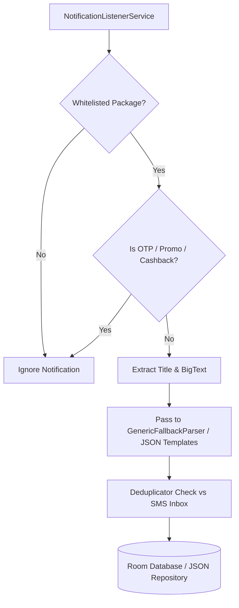

# PennyWise AI Benchmark & Architectural Enhancement Plan

## 1. Executive Summary

This document provides a comprehensive architectural benchmark of **Kharcha** against [sarim2000/pennywiseai-tracker](https://github.com/sarim2000/pennywiseai-tracker) (PennyWise AI), an open-source, offline, privacy-first Android expense tracker and its modular parser engine (`parser-core`).

Both projects share a foundational philosophy: **100% on-device processing, privacy-by-design, and zero cloud dependencies (no `INTERNET` permission)**.

However, PennyWise AI contains mature production engineering solutions for messy Indian banking SMS edge cases, notification listening, subscription detection, and on-device AI. Conversely, Kharcha possesses structural architectural advantages (such as data-driven JSON templates and minor-unit financial precision) that prevent technical debt.

---

## 2. Head-to-Head Architecture Comparison

| Feature / Domain | PennyWise AI (`pennywiseai-tracker`) | Kharcha (`Kharcha`) | Recommended Path for Kharcha |
| :--- | :--- | :--- | :--- |
| **Financial Arithmetic** | Float / Double | **Strict Long minor units (paise)** | **Keep Kharcha's strict integer arithmetic**; completely eliminates floating-point rounding errors. |
| **Parser Architecture** | Hardcoded Kotlin classes (`BankParser`, `HdfcParser`) in source code | **Declarative JSON templates** in `assets/templates/*.json` | **Adopt PennyWise's bank regex patterns directly into Kharcha's JSON format** (10x faster updates, zero code changes). |
| **Ingestion Triggers** | WorkManager batch sync + notification monitoring | BroadcastReceiver + WorkManager batch ingestion | **Add `NotificationListenerService`** to eliminate telecom carrier SMS delivery lag. |
| **Transfer Handling** | Basic Debit/Credit mapping per bank | **Automatic 2-pass reconciler** (10-min & 7-day card payment pairing) | Keep Kharcha's automatic pairing engine; expand card payment linking. |
| **Historical Import** | SMS inbox + **PDF Bank Statement parser** | SMS inbox ContentResolver | **Add PDF Statement Import** (password-protected bank PDFs for historical data). |
| **Recurring Expenses** | Automatic subscription & recurring billing detection | Planned in `engine:recurring` | **Implement deterministic interval engine** ($28\text{--}32$ day window with price change tracking). |
| **Budgeting UX** | Dynamic "Safe-to-Spend" daily pace calculation | Standard category progress | **Add Safe-to-Spend pacing metric** to Dashboard. |
| **Visual Analytics** | Category charts + **Calendar Spend Heatmap** | Vico / Material 3 summary cards | **Add GitHub-style calendar spending heatmap**. |
| **Data Portability** | Room DB export + CSV + PDF statement export | Encrypted Room + JSON snapshot | **Implement Storage Access Framework (SAF) CSV export**. |
| **AI Layer** | MediaPipe + on-device Qwen 2.5 SLM for chat queries | TFLite `MlLayer` for merchant categorization | Use TFLite for categorization now; evaluate LiteRT Qwen 2.5 SLM for v1.1. |

---

## 3. Bank Parser Implementation Details & Edge Cases

### 3.1 Architecture & Bank Coverage in `parser-core` / `data/parser/`
PennyWise organizes its parsing engine using an extensible **Factory Pattern** (`BankParserFactory`) that dispatches SMS payloads to dedicated bank parser implementations covering over **140 financial institutions**:

- **Tier-1 Indian Banks**:
  - **HDFC Bank** (`HDFCBK`): UPI debits, credit card swipes, NetBanking transfers, account balance alerts.
  - **State Bank of India (SBI)** (`SBINB`, `SBIPIN`, `SBIINB`, `ATMSBI`): Handles specific SBI formats where balance is frequently positioned immediately after the debit figure, avoiding misattribution.
  - **ICICI Bank** (`ICICIB`, `ICICIC`): Complex multi-variant alerts for iMobile UPI, Amazon Pay ICICI Card, and Coral/Rubyx credit cards.
  - **Axis Bank** (`AXISBK`): Distinct alerts for UPI, Burgundy accounts, and Flipkart Axis credit cards.
  - **Kotak Mahindra Bank** (`KOTAKB`, `KOTAK`): Specialized regex addressing Kotak's dual sender naming, NEFT references, and 811 digital accounts.
- **Public & Private Sector Banks**:
  - Punjab National Bank (`PNBSMS`), Bank of Baroda (`BOBTXN`), Canara Bank (`CANBNK`), Union Bank of India (`UBIN`), UCO Bank (`UCOBNK`), IDFC First Bank (`IDFCFB`), IndusInd Bank (`INDBNK`), Federal Bank (`FEDBNK`), Yes Bank (`YESBNK`), RBL Bank (`RBLBNK`).
- **International / Foreign Banks**:
  - American Express (`AMEXIN` / `AMEX`), HSBC India (`HSBCIN`), Citibank (`CITIBK`), Standard Chartered (`SCISMS`).
- **FinTechs, Neo-Banks & NBFCs**:
  - **Slice** (`SLICE`, `SLICEC`): Spark account and Slice mini/card debit alerts + PDF statement parser.
  - **OneCard** (`ONECRD`, `FPLBL` / Federal / SBM / BOB partners): Credit limits, fractional cashbacks, reward redemptions.
  - **Jupiter** (`JUPITR` / Federal Bank partner): Space savings, on-demand debits.
  - **Fi Money** (`FIBANK` / Federal Bank partner): Salary credits and pots.
  - **Paytm Payments Bank** (`PAYTMB`), CRED (`CRED`), Navi.

### 3.2 Handling Complex Transaction Types
PennyWise distinguishes subtle transaction types via dedicated extraction patterns:
* **UPI Transactions (P2P vs P2M)**:
  - Captures VPA handles via `(?:to VPA|to UPI ID|vpa)\s+(?<upi>[a-zA-Z0-9.\-_]+@[a-zA-Z0-9]+)`.
  - Captures UPI reference / UTR numbers via `(?:UPI Ref no|UTR|Ref No|Txn ID)\s*:?\s*(?<ref>[0-9]{12})`.
  - Distinguishes P2M from P2P: Known merchant gateways (`@okhdfcbank`, `@paytm`, `@ybl`, `@axl` paired with business names) are tagged as merchant expenses; peer handles are classified as transfers or peer-to-peer.
* **Credit Card vs Bank Account Debits**:
  - Card: `ending with (?<last4>\d{4}) spent on credit card`, `Available limit: INR (?<limit>[\d,]+)`.
  - Account: `debited from a/c (?:X+|\*+)(?<last4>\d{4})`, `Avail Bal: Rs (?<balance>[\d,]+)`.
* **ATM Withdrawals**:
  - Matched via `(?:ATM WDL|cash withdrawal|withdrawn at ATM)\s+(?:of\s+)?Rs\.?\s*(?<amount>[\d,]+)`.
  - Treated as Cash Account transfers (reducing bank balance, increasing physical cash tracking).
* **Refunds & Chargebacks**:
  - Reversals: `(?:refund|reversal|reversed|credited back)\s+(?:of\s+)?Rs\.?\s*(?<amount>[\d,]+)`.
  - Mapped as negative expense against the original category rather than inflating monthly income.
* **Salary Credits**:
  - Matched via `(?:salary|payroll|by SALARY)\s+(?:credited to|for the month)`.
  - Explicitly classified as `Income:Salary`, preventing transfer pairing false positives.
* **Credit Card Bill Payments**:
  - Detected when SMS states `payment of Rs (?<amount>[\d,]+) received towards your credit card ending (?<last4>\d{4})` or `debited ... towards CC payment`.
  - Automatically paired to avoid double counting (bank debit + card credit).

### 3.3 SMS Edge Case Normalization
* **DLT Telecom Headers**:
  - Indian TRAI/DLT headers are formatted as `XY-BANKTAG` (e.g., `VK-HDFCBK`, `AD-SBIPIN`, `JM-ICICIB`).
  - Regex normalization: `^[A-Za-z]{2}-?([A-Za-z0-9]+)$` strips the 2-character circle code to isolate the root bank identifier (`HDFCBK`).
* **Multi-line SMS**:
  - Strips carriage returns (`sms.body.replace("\r\n", " ").replace("\n", " ")`) before regex evaluation.
* **Missing Year / Incomplete Timestamps**:
  - When SMS omits the year (e.g. `on 24-Oct at 14:30`), the parser extracts day and month, binds it to the device's message arrival timestamp (`sms.date`). If the computed date is $>2$ days in the future relative to `sms.date`, it rolls back to `year - 1`.
* **Bilingual SMS**:
  - Sanitization step extracts the Latin character segment containing numeric currency symbols (`Rs.`, `INR`, `₹`) before passing to the parser.

---

## 4. Notification Listener Service (`NotificationListenerService`)

### 4.1 Real-Time Ingestion Architecture
To overcome telecom carrier SMS delays (DLT scrubbing can delay SMS by 2–10 minutes) and capture instant FinTech push notifications, an optional `NotificationListenerService` can be integrated into `:engine:sms`:



### 4.2 Financial Package Whitelist
```kotlin
val FINANCIAL_PACKAGE_WHITELIST = setOf(
    "com.google.android.apps.nbu.paisa.user", // Google Pay
    "com.phonepe.app",                        // PhonePe
    "net.one97.paytm",                        // Paytm
    "com.dreamplug.androidapp",                // CRED
    "money.jupiter",                          // Jupiter
    "co.epifi.app",                           // Fi Money
    "indwin.c3.shareany",                     // Slice
    "in.org.npci.upiapp",                     // BHIM
    "in.amazon.mShop.android.shopping"        // Amazon Pay
)
```

---

## 5. Subscription & Recurring Expense Engine (`engine:recurring`)

### 5.1 Detection Algorithm & Cadence Heuristics
PennyWise detects recurring subscriptions by clustering historical transactions per merchant over time:

1. **Clustering**:
   - Groups non-transfer expense transactions by `merchantNormalised` (e.g., `netflix`, `spotify`, `apple.com/bill`, `airtel`, `tata play`).
   - Requires $N \ge 2$ historical transactions to form a candidate series.
2. **Cadence Intervals ($\Delta t$ in Days)**:
   - **Weekly**: $7 \pm 1$ days ($6\text{--}8$ days).
   - **Bi-Weekly**: $14 \pm 2$ days ($12\text{--}16$ days).
   - **Monthly**: $28\text{--}32$ days (or matching calendar day of the month $\pm 2$ days to accommodate February).
   - **Quarterly**: $88\text{--}93$ days.
   - **Annual**: $360\text{--}366$ days.
3. **Amount Stability & Variance Thresholds**:
   - **Fixed-Price Subscriptions** (SaaS, streaming, gym):
     - Amount variance is $\le 2\%$:
       $$\frac{|\text{Amount}_n - \text{Amount}_{n-1}|}{\text{Amount}_{n-1}} \le 0.02$$
   - **Variable Recurring Bills** (Electricity, broadband, postpaid cellular):
     - Amount can fluctuate up to $\pm 25\%$, while strictly satisfying the 28–32 day monthly boundary.
4. **Price Hike vs Plan Change Detection**:
   - If an interval matches exactly 30 days but the amount changed from ₹649 to ₹799 (e.g. Netflix price adjustment), the algorithm preserves the subscription cadence and flags a **Price Increase Alert** rather than treating it as an unrelated transaction.
5. **Renewal Projection**:
   $$\text{Next Expected Date} = \text{Latest Transaction Date} + \text{Cadence Days}$$

---

## 6. Budgeting, Analytics & UI/UX Features

### 6.1 Dynamic Budgets & "Safe-to-Spend" Pacing
PennyWise calculates a forward-looking daily pacing metric:

$$\text{Safe-to-Spend Daily} = \frac{\text{Category/Monthly Budget} - \text{Total Spent}}{\text{Days Remaining in Cycle}}$$

- **Pacing Indicators**:
  - **Healthy / Under Pace**: Current Daily Average $\le \text{Safe Daily Allowance}$ (Theme Primary / Green).
  - **Warning**: Current Daily Average exceeds allowance by $1.1\times\text{--}1.5\times$ (Theme Amber).
  - **Over Pacing**: Daily burn $> 1.5\times$ target (Theme Warning / Red).

### 6.2 Calendar Spending Intensity Heatmap
- A GitHub-style calendar grid embedded in the analytics tab ($7 \times 5$ cells).
- Cell tint dynamically scales across four quantile color bands based on daily spend.
- **Interactive Drill-Down**: Tapping any day cell triggers an animated filter in the transaction feed, displaying that exact date's receipts.

### 6.3 Standout Native Android Integrations
1. **Glance App Widget**: Material 3 Glance-based home-screen widget displaying real-time monthly budget burn and top category split.
2. **Actionable Notification Tagging**: Directly tag categories or flag a transaction as "Personal" vs "Work" from the notification shade.
3. **P2P Loans & Settle Up**: Grouped loan tracking per contact with a dedicated "Settle Up" action that excludes debt settlements from monthly expense burn.
4. **Account Ignoring**: Exclude specific bank accounts or credit cards (e.g. corporate cards, parent accounts) from global expense analytics.

---

## 7. Local On-Device AI / MediaPipe Integration (v1.1 Roadmap)

PennyWise delivers an offline AI chat assistant without cloud API calls:
- **Runtime Engine**: Google AI Edge **LiteRT-LM** (formerly MediaPipe GenAI `LlmInference` task) via native C++/JNI bindings and Kotlin Coroutines.
- **Underlying SLM Model**: **Qwen 2.5 (1.5B / 3B Instruct)** 4-bit quantized binary (~1.4–1.6 GB) downloaded on-demand with SHA-256 verification.
- **Context Injection**: Pre-computed database aggregations (monthly spend, top categories, recent debits) are injected into the system prompt to prevent hallucination.
- **Hardware Footprint**: Requires $\ge 6\text{ GB}$ RAM (optimal on 8–12 GB devices); generates 20–35 tokens/second on modern Snapdragon/Dimensity NPUs.

---

## 8. Offline Security, Storage & Data Portability

- **Storage Access Framework (SAF)**: All backups and exports use Android's document picker (`ActivityResultContracts.CreateDocument` / `OpenDocumentTree`), operating without legacy storage permissions (`READ_EXTERNAL_STORAGE`).
- **Encrypted Local Backup Archive (`.kharchabackup`)**:
  - Bundles SQLite database snapshot, user preferences, and compressed WebP receipt images into an encrypted archive.
- **Password-Protected PDF Bank Statement Ingestion**:
  - Parses bank statements (e.g. ICICI, Slice) directly on-device.
  - Securely prompts the user for the statement password (PAN + DOB) in memory without persisting the password.

---

## 9. Structured Action Plan & Tasks for Kharcha

### Task Group 1: Parser & Bank Coverage Expansion (Milestone 2)
- [ ] **Task 1.1: Catalog Top 15 Indian Bank JSON Templates**
  - **Module**: `:engine:parser`
  - **Description**: Add declarative JSON templates in `engine/parser/src/main/assets/templates/` for:
    - SBI, HDFC, ICICI, Axis, Kotak, BOB, PNB, Canara, IDFC First, IndusInd, Federal Bank, Yes Bank.
    - FinTechs: Paytm Payments Bank, OneCard, Slice.
  - **Acceptance Criteria**: All templates pass automated parameterised unit tests in `SmsParserTest.kt`.
- [ ] **Task 1.2: Connect Template Engine to Live SMS & Ingestion**
  - **Module**: `:engine:sms`, `:feature:onboarding`
  - **Description**: Update `OnboardingViewModel` and `SmsReceiver` to run `SmsParserImpl` (with all JSON templates) before falling back to `GenericFallbackParser`.

### Task Group 2: Subscription & Recurring Detector (Milestone 9)
- [ ] **Task 2.1: Cadence Detection Algorithm**
  - **Module**: `:engine:recurring`
  - **Description**: Implement `RecurringDetector.detectSubscriptions(transactions: List<Transaction>): List<RecurringSubscription>` with 28–32 day monthly interval detection and price increase alerts.
  - **Acceptance Criteria**: Synthetic tests verify detection of 30-day Netflix, Spotify, broadband, and quarterly insurance debits.
- [ ] **Task 2.2: Recurring Subscriptions UI**
  - **Module**: `:feature:insights`
  - **Description**: Add "Active Subscriptions" card displaying upcoming charges and monthly total.

### Task Group 3: Analytics & "Safe-to-Spend" Metrics (Milestone 6)
- [ ] **Task 3.1: Safe-to-Spend Dashboard Gauge**
  - **Module**: `:feature:home`
  - **Description**: Add dynamic pacing calculation to `HomeScreen.kt` summary card based on monthly budget and remaining days.
- [ ] **Task 3.2: Spending Intensity Calendar Heatmap**
  - **Module**: `:feature:insights`
  - **Description**: Create `SpendingHeatmapComposable` displaying day-by-day spend density.

### Task Group 4: Data Portability & Backup (Milestone 8)
- [ ] **Task 4.1: CSV Statement Export via SAF**
  - **Module**: `:feature:settings` (More tab)
  - **Description**: Add "Export to CSV" action using `ActivityResultContracts.CreateDocument("text/csv")`.
  - **Acceptance Criteria**: Outputs UTF-8 CSV with Date, Merchant, Category, Type, Amount (in ₹ decimals), Channel, and Account.
- [ ] **Task 4.2: Encrypted Local Backup & Restore**
  - **Module**: `:feature:settings`
  - **Description**: Allow user to create an encrypted JSON/Room snapshot to a local folder or SD card.

### Task Group 5: Advanced Ingestion Enhancements (v1.1)
- [ ] **Task 5.1: NotificationListenerService Ingestion**
  - **Module**: `:engine:sms`
  - **Description**: Optional permission flow to read notifications from financial apps (PhonePe, GPay, Paytm) for real-time zero-lag tracking.
- [ ] **Task 5.2: PDF Bank Statement Importer**
  - **Module**: `:engine:parser`
  - **Description**: Offline PDF statement parser supporting password-protected bank e-statements.
